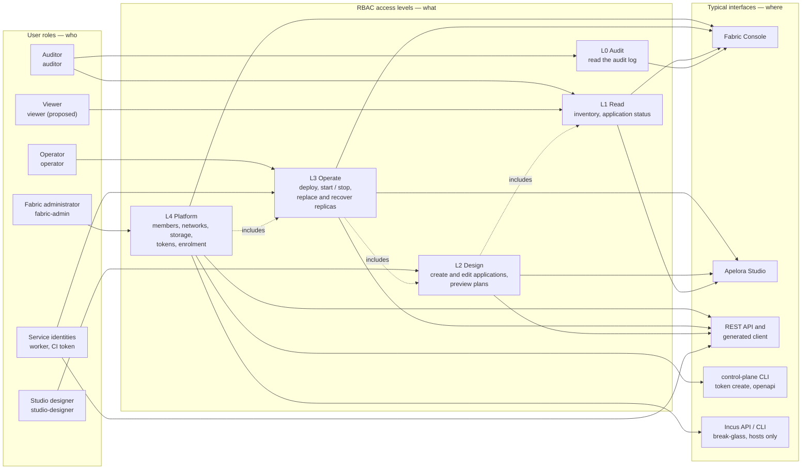
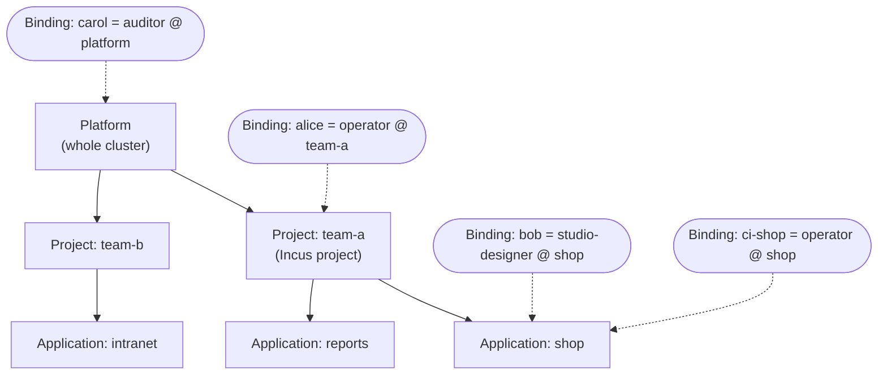
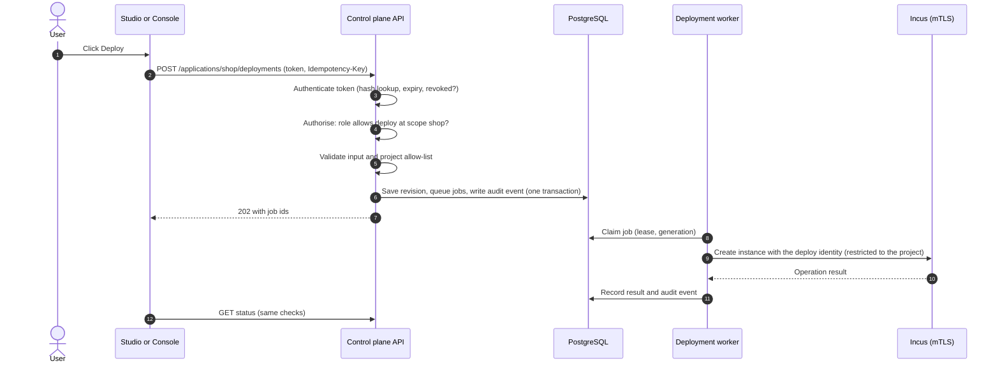
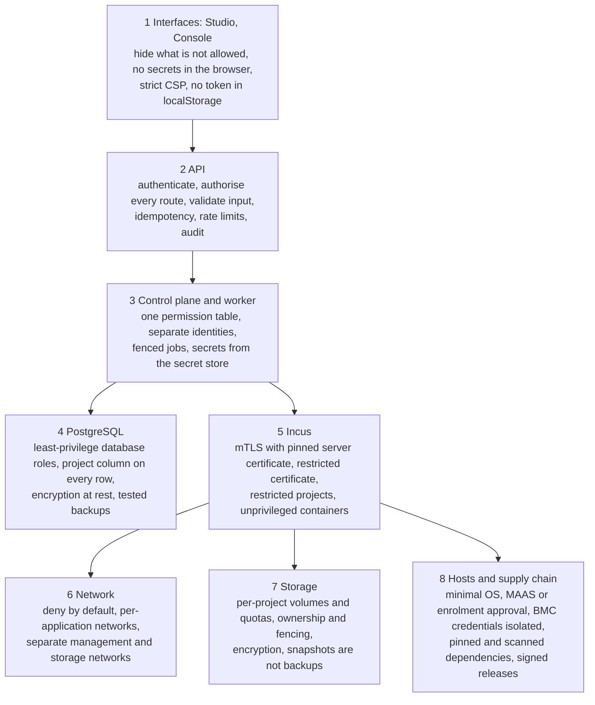

Status: **core built.** Scoped roles, OIDC validation, the evaluator, approvals, emergency access, service identities and audit are implemented and tested; see [identity and authorization](IDENTITY-AND-AUTHORIZATION.md) for what is built and what is NOT VERIFIED (live identity provider, MAAS, Incus restricted projects). This document keeps the design rationale.

Evidence labels used below: **BUILT** (in the repository and tested), **PROPOSED** (agreed direction, not built).

## 1. Principles

1. **The server decides.** The Studio and the Console hide or disable what a person may not do, but only to be helpful. Every API route names the permission it needs and checks it on the server.
2. **One place maps roles to permissions** (`Role::allows` in `crates/domain`). No route, screen or script re-implements it.
3. **Least privilege, separated duties.** A designer can propose; an operator can run; an administrator can change the platform; an auditor can only read. No role is needed for everything.
4. **Two authorities, never mixed.** Apelora decides who may design, deploy and operate *applications*. Incus decides what a certificate may do *inside Incus*. The browser never holds Incus credentials.
5. **Defence in depth.** A mistake in one layer (a missing check in a screen) must not be enough to cause harm in the next.
6. **Everything that matters is audited,** with who, what, when, on which object, and the outcome. Secrets never appear in the audit log.

## 2. User roles, access levels and interfaces

The following diagram shows how user roles relate to RBAC access levels and the typical interfaces they use.

How to read it: a role grants one access level; a higher level includes the ones below it (a solid line from a level to an interface means that interface offers actions at that level). The Incus API is reachable only from hosts, by administrators, as break-glass (see §7); applications and tenants never touch it. Service identities use the API only; the deployment worker additionally holds the Incus deploy identity, restricted to its projects.

### 2.1 Roles today and proposed

| Role | State | Purpose | Cannot |
|---|---|---|---|
| `fabric-admin` | BUILT | Runs the platform: members, networks, storage, enrolment, tokens | — (all permissions) |
| `operator` | BUILT | Runs workloads: deploys and operates applications | Change infrastructure or tokens |
| `studio-designer` | BUILT | Designs applications in the Studio | Deploy, change infrastructure |
| `auditor` | BUILT | Reads inventory and the audit log | Design, deploy, change anything |
| `viewer` | PROPOSED | Stakeholders: sees applications and their health, no audit log, no inventory of other tenants | Anything that changes state |
| Service identities | BUILT (tokens) / PROPOSED (scopes) | Worker, CI, integrations; short-lived, narrow, never a person's token | Interactive use |

### 2.2 Permissions

| Permission | BUILT meaning | PROPOSED split |
|---|---|---|
| `read-inventory` | Members, instances, networks, pools, applications | `read-applications` (per project) separate from `read-inventory` (infrastructure) |
| `read-audit` | Audit log | Unchanged; may be scoped to a project |
| `manage-tokens` | Create and revoke API tokens | Unchanged; platform scope only |
| `manage-infrastructure` | Members, enrolment, evacuation, join tokens | Add `manage-storage` and `manage-networks` so storage or network teams need not be full administrators |
| `design-applications` | Create and edit designs, preview plans | Add `approve-deployment` for optional four-eyes release control |
| `deploy` | Deploy, start, stop, delete instances in allowed projects | Add `operate-instances` (start/stop/restart) apart from `deploy` (create/remove) |

### 2.3 Matrix (BUILT)

| Capability | fabric-admin | operator | studio-designer | auditor |
|---|:-:|:-:|:-:|:-:|
| See inventory and application status | ✓ | ✓ | ✓ | ✓ |
| Create and edit application designs, preview a plan | ✓ | ✓ | ✓ | — |
| Deploy, start, stop, delete application instances | ✓ | ✓ | — | — |
| Members, evacuation, machine enrolment, join tokens | ✓ | — | — | — |
| See alerts (`cluster.view`) | ✓ | ✓ | ✓ | ✓ |
| Acknowledge and silence alerts (`alert.respond`); change alert rules and webhooks (`alert.configure`) | ✓ | — | — | — |
| API tokens | ✓ | — | — | — |
| Audit log | ✓ | — | — | ✓ |

## 3. Scope: who may do it *where* (PROPOSED)

Today a role applies to the whole platform and deployments are limited by the allow-list `APELORA_DEPLOY_PROJECTS`. The target binds a role to a **scope**, so a team can design and run its own applications and see no one else's.

- A **role binding** is `(identity, role, scope)`. A binding at a scope applies to everything beneath it.
- The `fabric-admin` and `auditor` roles are normally bound at platform scope. Designers and operators are bound at project or application scope.
- Each Apelora project maps to one Incus project (restricted, see §5). This keeps the Apelora authorisation and the Incus isolation aligned.
- Bindings live in PostgreSQL and are managed by administrators in the Console. Changes are audited.

## 4. Request path: how one action is authorised

Points that matter: the check happens on the server (step 3), the audit write is in the same transaction as the work it describes (step 5), and the worker uses a **different, narrower** identity than the API's administrator identity (step 8, [ADR 0003](../adr/0003-incus-identities-and-cluster-join.md)).

## 5. Best practice by layer

| Layer | Do (BUILT unless marked) | Add (PROPOSED) |
|---|---|---|
| **Interfaces** | Navigation and buttons follow `whoami` permissions; the API token lives in `sessionStorage` of the tab, never `localStorage`; the browser talks only to the Apelora API; destructive actions need typed confirmation; no secret values in designs (secret properties hold a reference name) | Content-Security-Policy and other security headers on both apps; sign-in with OIDC (authorisation code with PKCE) and short-lived tokens; idle sign-out; no sensitive data in URLs |
| **API** | Authentication and a named permission on every route; hashed tokens with expiry and revocation; input validated; `Idempotency-Key`; audit events; OpenAPI as the contract | Per-project scope on every route; rate limiting and request size limits; consistent error bodies that never reveal internals; `ETag`/`If-Match` on documents; CORS allow-list |
| **Control plane and worker** | Permission table in one crate; two Incus identities (deploy identity restricted to projects, admin identity only for cluster administration); jobs with leases and fencing generations; secrets not logged (`Debug` redaction) | Secrets from a secret store (not environment files); short-lived credentials for CI; periodic access review report; break-glass procedure with alarm |
| **PostgreSQL** | Apelora state only; migrations in the repository | Separate database roles: application (no DDL, no superuser), migration, read-only reporting; TLS to the database; row filters by project; encryption at rest; backup restore drill |
| **Incus** | mTLS with server-certificate pinning; deploy identity restricted to listed projects; restricted projects; unprivileged containers; no host mounts or raw configuration for tenants; healing off by default | Certificate rotation on a schedule (runbook exists); audit of Incus-side events correlated with Apelora's; project limits (CPU, memory, disk, instance counts) per tenant |
| **Network** | Deny-by-default connections compiled from the graph; per-application OVN networks and ACLs; internet access only through an explicit `@external` | Management, storage and BMC networks separated and not reachable from tenant networks; egress allow-lists |
| **Storage** | Ownership labels (`user.apelora.*`) written only by Apelora | Volumes created per project with quotas; encryption where the backend supports it; restore tests; fencing before any stateful move ([storage](STORAGE.md)) |
| **Hosts and supply chain** | `cargo deny`, npm licence and audit checks, secret scanning, draft releases with checksums, pinned Incus version (`upstream.lock.yaml`) | Signed release artefacts and a software bill of materials; minimal host image; host patching runbook; separate credentials per environment |

## 6. Identity

| Identity | State | Notes |
|---|---|---|
| People | BUILT: API tokens created by an administrator, shown once, hashed in storage, with a role, expiry and last-use | PROPOSED: OIDC sign-in; groups from the identity provider map to role bindings; multi-factor authentication is the provider's job; tokens remain for automation only |
| Automation | BUILT: API tokens | PROPOSED: tokens bound to one scope and role, short expiry, named owner, visible in the Console |
| Apelora → Incus | BUILT: deploy identity (restricted) and admin identity (unrestricted) as two certificates | Rotate on schedule; store only in the backend's secret store |
| Hosts → cluster | BUILT: single-use join tokens issued after an administrator approves the machine | MAAS provisioning later ([ADR 0002](../adr/0002-bare-metal-provisioning-maas.md)) |

## 7. Break-glass

Direct access to Incus on a host bypasses Apelora's authorisation and audit. It exists for outages (for example loss of quorum, see the runbooks) and is therefore: limited to a few named administrators, done from the host, announced, followed by a written account, and reconciled afterwards (Apelora reads actual Incus state before acting). It is never offered to tenants or designers. *PROPOSED:* alert when an Incus-side change has no matching Apelora audit event.

## 8. What to build, in order

1. Document the current roles in the Console administration view (read-only list of roles and what they allow). *Small.*
2. Project scoping: add a project column to applications and bindings; check scope in the authorisation helper; tests that a designer in project A cannot read project B.
3. `viewer` role and the permission split (`read-applications`, `operate-instances`).
4. Security headers and CSP for both apps.
5. OIDC sign-in and group-to-role mapping.
6. Optional release approval (`approve-deployment`).

Each step needs tests on the server first (a role without the permission gets 403 on every affected route), then UI behaviour, then a real-browser check. Keep the list of routes and the permission each needs generated from the code or the OpenAPI document so it cannot drift.
