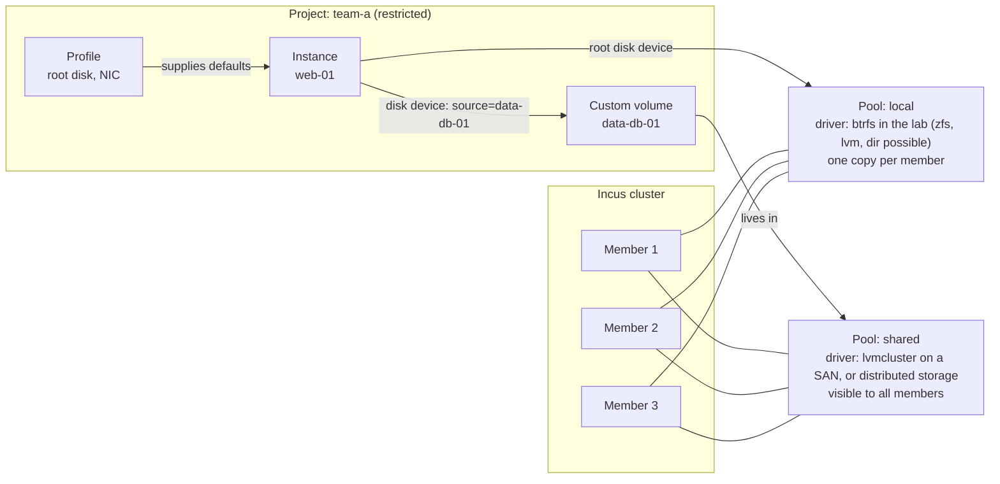
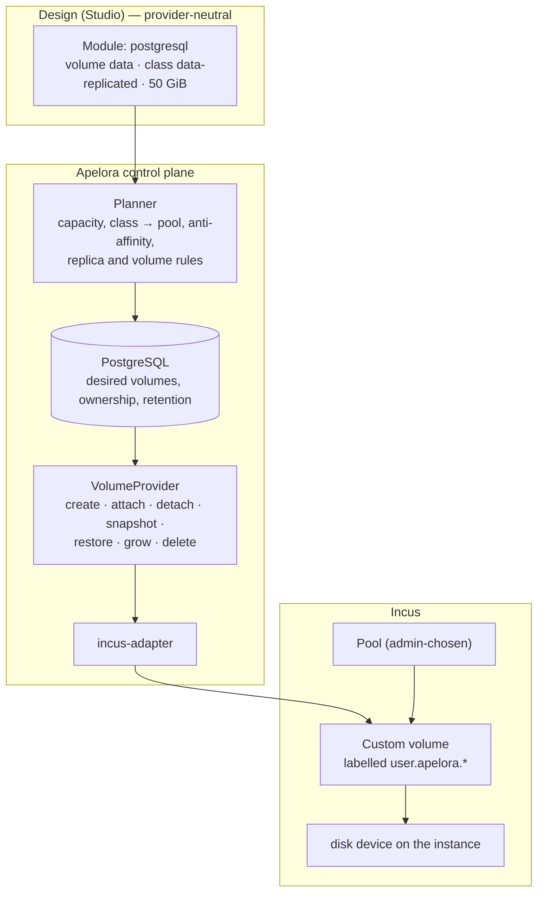
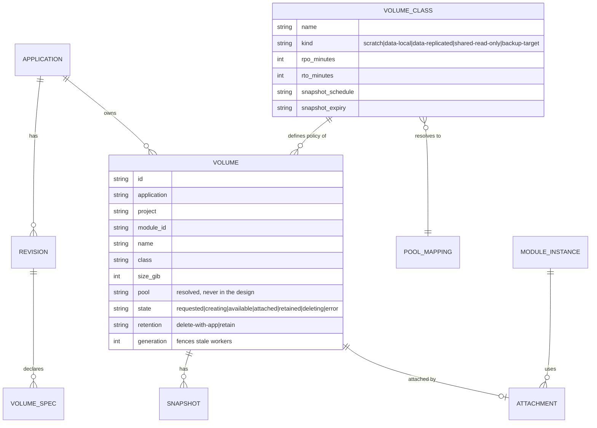
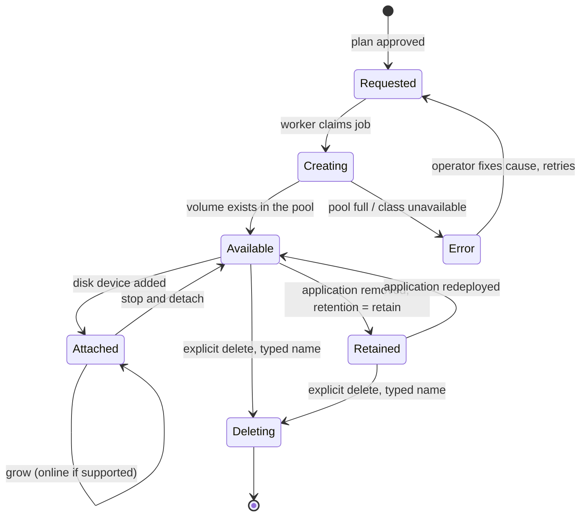
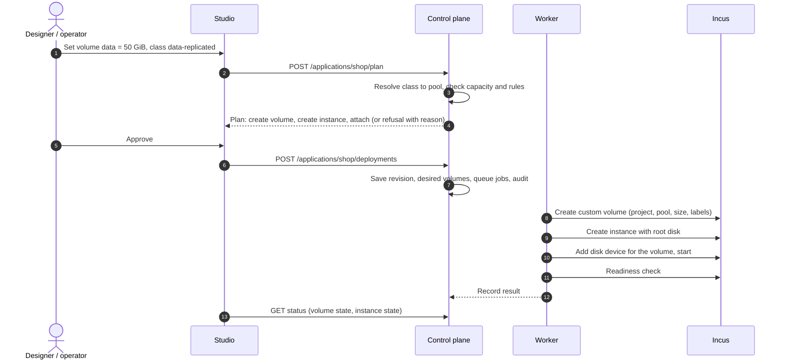

Status: **target design, partly built** (2026-10-21; the authoritative list is [current state](current-state.md)). Built and REAL INCUS TESTED: the storage pool list with how full each is (`GET /api/v1/storage/pools`, Fabric Console); root disks from the project's default profile on the member's `local` pool (btrfs in the lab); `data-local` volumes (`<instance>-<volume>` on the pool in `APELORA_VOLUME_POOL`, on the instance's member), with records, listing, grow and explicit delete; snapshots (manual and scheduled, restore); backups copied into the `backup` pool on another member (scheduled or on request); moving an instance with its volumes (`instance.move`). Built 2026-10-21 (MOCK VERIFIED; the restore job REAL INCUS TESTED on the lab, the dry run and the Console dialog were not part of that run): the backup API and the Console's Storage page — backups per volume, back up now, delete a backup with its name typed (MOCK VERIFIED, not run on the lab), schedules, restore from a backup (§10, step 5) and volumes no application uses. Built 2026-10-21 (HA slice B, [ADR 0013](../adr/0013-fencing-before-restart.md)): the `data-replicated` class on the shared pool (`APELORA_SHARED_POOL`), with the module's root disk there too, and restart on another member after its member fails and is fenced — REAL INCUS TESTED on the lab's `shared` pool (clustered LVM on an iSCSI SAN, `scripts/test-cluster/shared-storage.sh`; drill timings in the [member-failure runbook](../runbooks/member-failure.md#modules-on-shared-storage)). **Not built:** the Console view for classes, choosing `data-replicated` in the Studio (the API accepts it), deleting a backup, Ceph-specific fencing. How a module's volumes fit the rest of the chain: [platform architecture §4.1](PLATFORM-ARCHITECTURE.md#41-from-an-application-to-running-instances). Statements about Incus below come from its documentation unless §10 records them as REAL INCUS TESTED on the pinned release (7.0.1); each build step verifies what it relies on, on the disposable test cluster, and records the result. Date: 2026-10-20. Related: [platform architecture](PLATFORM-ARCHITECTURE.md) §8, [ADR 0001](../adr/0001-incus-first.md), skills `storage-recovery` and `storage-volumes`.

## 1. How Incus models storage

| Object | What it is |
|---|---|
| **Storage pool** | A place where Incus keeps data, backed by a *driver* (for example directory, btrfs, LVM, ZFS, Ceph RBD, CephFS). Created and operated by an administrator. |
| **Volume** | A unit of data inside a pool. Kinds: instance volumes (a container's or VM's root), **image** volumes (cached images), **custom** volumes (data you create and attach). A custom volume has a content type: *filesystem* or *block*. |
| **Disk device** | How an instance uses storage: its **root disk** (`pool`, path `/`, optional `size` quota) and any attached custom volume (`source`, `pool`, `path`). Usually inherited from a **profile**. |
| **Snapshot / backup** | Snapshots live in the same pool as their volume. Backups are exported archives that can be stored elsewhere. |
| **Project** | Scopes instances, images, profiles and (by project features) custom volumes, and can **restrict** which devices and pools a tenant may use and how much it may consume. |
| **Bucket** | S3-style object storage offered by some drivers; not used by Apelora yet. |

### 1.1 Local pools and shared pools (the part that decides HA)

| | Local pool (directory, btrfs, LVM, ZFS) | Shared pool (clustered LVM on a SAN; distributed storage such as Ceph RBD or CephFS) |
|---|---|---|
| Where data is | On **one member's** disks. In a cluster the pool exists on every member under the same name, each with its own storage. | In a storage system **outside** Incus that every member reaches over the network |
| Move an instance to another member | Data must be **copied**: planned stop, copy, start | The instance can start elsewhere **without copying data**; live migration depends on instance type and is never assumed |
| Member fails | Data is **unavailable** until the member returns (or a backup is restored) | Data remains reachable; another member may start the instance **after** fencing proves the old one cannot write |
| Cost / complexity | Low, fast, simple | A separate system to deploy, monitor and upgrade |

Rule from the architecture: *a local pool across several members is not shared data.* Apelora must say so in plans instead of implying failover that cannot happen.

Two kinds of shared pool, side by side: **clustered LVM on a SAN** (`lvmcluster`: every member logs in to the same block device over iSCSI, Fibre Channel or NVMe over fabrics, and a lock manager coordinates the volume group; thick volumes, no snapshots of shared custom volumes) and **distributed storage** (a separate cluster of storage machines that replicates data). The lab runs the first: pool `shared` on an iSCSI LUN from the `apelora-san` VM ([test cluster](../development/TEST-CLUSTER.md)). Apelora puts `data-replicated` volumes and their modules' root disks there and restarts them on another member once a failed member is fenced (slice B of [moving modules](../design/mobility-and-ha.md), ADR 0013). On `lvmcluster` Incus activates container file systems exclusively but VM disks and block volumes shared, so only the failed host's dead sanlock lease, not the LV lock, rules out a second writer of a VM disk.

## 2. Where Apelora fits: one authority per piece of state

| Concern | Authority |
|---|---|
| Pools, drivers, disks, replication, Ceph health | **Administrators and Incus** (Apelora reads and reports, never configures a driver) |
| Volumes of an application: what exists, how big, which class, who owns it, retention | **Apelora** (desired state in PostgreSQL) |
| Creating, attaching, snapshotting, resizing, deleting volumes | **Incus**, driven by Apelora's worker through the adapter |
| Which member runs a stateful instance | **Incus** places; **Apelora** constrains it (a local volume pins the instance to its member) |

Apelora never writes Incus's database and never invents its own volume store or cluster filesystem.

## 3. The abstraction: designers pick a class, not a pool

A design must not contain pool names, driver names, hosts or addresses (same rule as hosts: [architecture](PLATFORM-ARCHITECTURE.md) §4). Instead:

- An **module class** declares the volumes it can use: name, mount path, default size, whether required, and a suggested class. (A database class asks for `data`; a web server asks for none.)
- A **volume class** is an Apelora policy an administrator defines and maps to a pool. The designer chooses a class and a size.
- Administrators map each class to a pool in the Console. If no pool can satisfy a class, the plan says so and refuses; it never silently falls back to a weaker pool.

| Volume class | Meaning | Typical backing | Relocation | Deleted with the application? |
|---|---|---|---|---|
| `scratch` | Disposable working space | Local pool, instance root | Recreated | Yes |
| `data-local` | Persistent, one writer | Local pool | Planned stop, copy, start | **No** (retained) |
| `data-replicated` | Persistent, one writer, survives a member loss | Shared pool (`APELORA_SHARED_POOL`); the module's root disk goes there too | Moves without copying; restart elsewhere after fencing (built, ADR 0013) | **No** (retained) |
| `shared-read-only` | Many readers (assets, models) | Filesystem on a shared pool | Not applicable | No |
| `backup-target` | Receives backups | Separate pool or external target | Not applicable | No |
| `secret` | Not a volume: a reference resolved from the secret store at start | Secret store | Not applicable | Not applicable |

### 3.1 Rules (carried from the `storage-volumes` skill, restated for this design)

1. Removing a module from the canvas **never** deletes data. Deleting a volume is an explicit, typed-name confirmed action; retained volumes show as *orphaned* until an owner decides.
2. A read-write **block** volume attaches to at most one instance. A design that gives several replicas the same exclusive volume is invalid (validation error with a hint: use one volume per replica or a shared filesystem class).
3. Resize is **grow-only** by default; shrinking is not offered.
4. Snapshots are taken stopped or with an application-aware hook unless the backend guarantees consistency; Apelora records which one was achieved. **Snapshots are not backups.**
5. All operations are idempotent and level-triggered like every other desired state: re-read Incus, then act.
6. Encrypt at rest where the backend supports it; keys are referenced, never stored in designs or the database.
7. Ownership labels `user.apelora.application`, `user.apelora.module`, `user.apelora.volume` are written only by Apelora; anything without them is never touched.

## 4. Data model (PROPOSED)

## 5. Lifecycle

### 5.1 Deploying a module with a volume

## 6. Interaction with mobility and recovery

| Workload | Volume | Evacuation / failure behaviour |
|---|---|---|
| Stateless replicas | none (or `scratch`) | Replace then retire; no data to move |
| Stateful single instance | `data-local` | **Blocked** for automatic recovery. Planned maintenance offers *stop, copy, start* with the size and an estimated interruption; member failure waits for the member or a restore |
| Stateful single instance | `data-replicated` | Restarts on another member **only after** the failed member is fenced (dead storage lease, or a person's confirmation) and only for Apelora's own instances (built, ADR 0013) |
| Replicated database | One volume per replica | Application-specific failover adapter; Apelora does not guess |

The evacuation dry run lists every volume that blocks a move and why. It never reports "no downtime" for stateful workloads.

## 7. Security

- Volumes are created in the **application's project**, with project limits on disk and volume counts; tenants cannot reach other projects' volumes.
- Restricted projects allow only managed (Apelora-created) disk devices: no host path mounts, no raw device passthrough for tenants.
- Pool configuration and driver credentials (for example Ceph keys) are administrator-only and live in the backend's secret store, never in the browser, designs, logs or the repository.
- Storage actions require their own permission (`manage-storage`, see [roles](ACCESS-AND-ROLES.md)) and are audited.
- Backup copies are independent of the pool they protect.

## 8. Failure handling

| Failure | Behaviour |
|---|---|
| Pool full or class unavailable | Plan refuses with the reason; nothing is changed |
| Create succeeds but attach fails | Volume stays `available`; the job retries; the application is reported as not ready |
| Worker crashes between steps | Next worker re-reads Incus (labels, devices) and continues; generation number stops a stale worker |
| Member with a `data-local` volume fails | Application reported unavailable; no automatic recovery; runbook offers restore from backup |
| Shared storage unreachable | Instances may stall; health shows storage as a separate detector; no automatic restart that could create two writers |
| Someone resizes or deletes a volume in Incus directly | Detected as drift on the next reconcile; reported, not silently "fixed" for destructive differences |

## 9. UI

- **Studio:** a *Volumes* section in the module properties (add volume, class, size, mount path); a small disk badge on the node; validation messages for rule 2 and unavailable classes; the deploy review lists volumes to create, keep, grow or leave retained.
- **Fabric Console, Storage:** pools (exists), volume classes and their pool mapping (admin), volumes per project with state, attachment, size and used space, snapshots, orphans; destructive actions need the typed name.

## 10. Build order

**Step 1 progress (REAL INCUS TESTED, 2026-10-20, Incus 7.0.1, btrfs pool `local` on four members, through the restricted deploy identity):**

| Check | Result |
|---|---|
| Create a filesystem custom volume in the restricted project | Works (`features.storage.volumes=true`); it lands on the member that received the request unless `target` is given; the restricted identity **may** target volumes (it may not target instances) |
| Size quota | Enforced: a 1 GiB volume stopped a write at 1.0 GiB (`df` inside shows the pool, not the quota) |
| Attach at creation | Works when the instance runs on the volume's member |
| Placement and a member-local volume | **Incus does not follow the volume**: an instance referencing a volume on another member failed (`Storage volume not found`). Working order: create the instance stopped (Incus places it), create the volume on that member, add the disk device, start — verified |
| Host-path disk in the restricted project | Refused (`Attaching disks not backed by a pool is forbidden`) |
| Grow while attached and running | Works (512 MiB → 1 GiB) |
| Shrink | **Accepted by Incus** (1 GiB → 256 MiB): Apelora must enforce grow-only itself |
| Snapshot | Refused in a restricted project unless an administrator sets `restricted.snapshots=allow` (`doesn't allow for snapshot creation`); with it, the restricted identity snapshots a volume, also while it is attached and running (crash-consistent only). The test cluster scripts set it |
| Restore | Refused while the instance runs (`Cannot restore custom volume used by running instances`); after a stop, `PUT` with `restore` brought back the snapshot's data (verified with a marker file) |
| Attach to a VM | A `block` volume appears as a second disk (`sdb`); a `filesystem` volume added to a running VM is mounted over virtiofs |
| Instance deleted | The volume stays, with `used_by` empty: data outlives the instance, so Apelora must track and delete volumes itself |
| Delete | Deletes the volume together with its snapshots, in one call |
| Evacuation | Incus **stops** an instance with a member-local volume in place (it does not move it) and starts it again when the member is restored |
| `used_by` | Lists the instances the volume is attached to |

Step 1 is complete. Consequences for step 2 and later: create order is instance (stopped) → volume on its member → disk device → start; grow-only and deletion are Apelora's rules, not Incus's; a project needs `restricted.snapshots=allow` before snapshots are offered; evacuation of a member with `data-local` volumes means downtime, never a move.

**Step 2 progress (part A, 2026-10-20):** volumes are part of the instance spec (`apelora_domain::storage::VolumeMount`: name, size in MiB, `filesystem` or `block`, class, mount path; at most four; block only for virtual machines; stateless modules cannot have them). The control plane resolves the class to the pool in `APELORA_VOLUME_POOL` and refuses a design with volumes when it is unset or Incus has no such pool; a caller can never name a pool. The worker creates the instance stopped, then each volume `<instance>-<volume>` on the instance's member with ownership labels, attaches it as `vol-<volume>` and starts the instance; a volume that exists without Apelora's labels or for another application is refused. Deleting the instance keeps the volume. The adapter's operations are methods of `Provider` (as for networks) rather than a separate trait; the mock holds volumes and injects create and attach failures. REAL INCUS TESTED: `volumes_follow_the_instance_and_outlive_it`. **Part B (2026-10-20):** the worker records each volume as soon as it exists (`volumes`, migration 0012; an application with recorded volumes cannot be deleted from the database). `GET /api/v1/applications/{name}/volumes` lists them with what Incus reports now (attached, kept, missing); `DELETE …/volumes/{volume}` deletes one with its snapshots after the name is typed again, refused while an instance uses it, needs `application.delete`, audited `application.volume.delete`. The Fabric Console shows them under Applications → Show details. REAL INCUS TESTED (four members): volumes on two members, one kept after its module was removed, both deleted from the console and the API. Runbook: `docs/runbooks/volumes.md`. **Step 3 (2026-10-20):** `@apelora/assembly-model` has `VolumeSchema` (name, size in MiB, mount path; unique names and paths, at most four), class defaults in `runtime.volumes` and per-module `volumes` (absent: the class's). `instanceRequestFor` sends them as `spec.volumes` and refuses them for stateless classes. The Studio's Properties window has a Volumes section (add, rename, mount path, size in GiB, remove; every change checked before it is kept) and the deploy review lists what each module keeps. Filesystem volumes only in the Studio for now; block volumes for virtual machines are accepted by the API. Grow: `PATCH /api/v1/applications/{name}/volumes/{volume}` with `sizeMib` (needs `application.deploy`, audited `application.volume.grow`) and *Grow…* in the Fabric Console; grow-only, refused before Incus is asked; REAL INCUS TESTED on a running instance. Snapshots (step 5, first part): `GET|POST /api/v1/applications/{name}/volumes/{volume}/snapshots`, `POST …/snapshots/{snapshot}/restore` (name typed, refused while an instance using the volume runs, approval where the policy asks), `DELETE …/snapshots/{snapshot}`; snapshots are named `snap-YYYYMMDD-HHMMSS` and the response says `crash-consistent` or `stopped`; a project without `restricted.snapshots=allow` is reported as such. REAL INCUS TESTED (adapter test, and take, refused restore, restore after stop and delete from the Fabric Console against the cluster). Next: the Console Storage view for classes and orphans (step 4), scheduled snapshots and backups to a separate pool.

**Step 4 and 5, backups and restore (2026-10-21, MOCK VERIFIED with a real PostgreSQL):**

- **Read side.** `GET /api/v1/storage/pools` (`cluster.view`): each pool's use per member from the members' state, a shared pool counted once, and what Apelora uses it for (`APELORA_VOLUME_POOL`, `APELORA_BACKUP_POOL`, which the control plane now reads too). `GET /api/v1/storage/volumes` (per application the caller may view): every recorded volume with what Incus reports (one custom-volume list per project and pool), its schedules and how many backups it has. `GET /api/v1/storage/orphans` (`cluster.view`): custom volumes in Apelora's projects (deploy projects and every environment's) that neither the `volumes` nor the `volume_backups` table records, with their size and why they are listed; read-only.
- **Per volume.** `GET …/volumes/{volume}/backups` (`application.view`) lists its backups, oldest first, with whether each still exists in Incus and the volume's schedules. `POST …/backups` (`application.operate`) queues a `volume.backup` job (the existing worker job; its audit row `application.volume.backup.requested` is written with the job). `PUT …/schedules` (`application.deploy`) sets or clears the snapshot and backup schedules (15 minutes to a week, keep 1–50; backups need a backup pool), audited `application.volume.schedules` in the same transaction.
- **Restore from a backup.** `GET …/backups/{backup}/restoration` is the dry run (`apelora_domain::storage::plan_restore`): the volume, the backup and when it was taken, the volume's snapshots that will be deleted, the instances using it and which run, where the safety backup goes, what blocks it and the steps. `POST …/restore` runs the same check again, needs the volume's name typed, `application.operate` (and an approval where a policy asks) and queues a `volume.restore` job with its audit row (`application.volume.restore.requested`) in one transaction. The job (`deployment-worker/src/storage.rs`) re-reads Incus before each change: refused (nothing changed) while an instance using the volume runs or when the volume or the backup is missing; then a **safety backup** of the current data into the backup pool, recorded with the job (`volume_backups.before_restore`, migration 0024), so a retried attempt finds it instead of taking another; then a **safe point** (a cancellation stops here, keeping the safety backup); the check again; then an Incus `refresh` copy of the backup over the volume — one Incus operation, no safe point inside; a copy that fails part-way is repeated whole by the next attempt and the safety backup holds what was there. Incus deletes the volume's own snapshots during a refresh and would accept it under a running instance (REAL INCUS TESTED earlier, [test cluster](../development/TEST-CLUSTER.md)): Apelora refuses that first. The instances stay stopped; the person starts them after checking the data. A failed restore is not retried as is (the dry run is read and the name typed again). Audited `application.volume.restored` by the worker. Runbook: [volumes](../runbooks/volumes.md#restore-a-volume-from-a-backup).

1. Verify on the test cluster, labelled REAL INCUS TESTED: custom volume create, attach to a container and to a VM, snapshot, restore, grow, delete, and the project restrictions in §7; write down what the pinned release actually does.
2. `VolumeProvider` trait, fake provider with fault injection, adapter implementation, `volumes` table and migration.
3. Module class `volumes` field and Studio properties section; planner rules; deploy review.
4. Console Storage: classes, volumes, orphans.
5. Snapshots and scheduled backups with a restore drill; then relocation of `data-local` volumes (stop, copy, start).
6. Only with a verified shared pool and tested fencing: `data-replicated` recovery (M3).
