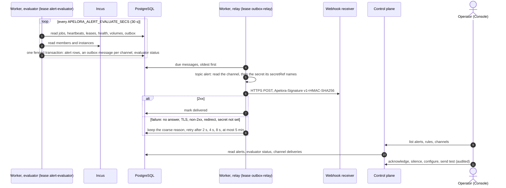

Status: **built (first slice), MOCK VERIFIED** · Date: 2026-10-21 · Related: [ADR 0011](../adr/0011-one-design-every-size.md) (the outbox is the single delivery mechanism), [one design at every size](../architecture/EVERY-SIZE.md), [monitoring](../architecture/MONITORING.md), [Console plan](../development/CONSOLE-PLAN.md) ("Alerts and events", P0), [alerts runbook](../runbooks/alerts.md)

## 1. Problem and scope

An operator must learn that something in Apelora or in an application needs attention without watching the Console: a job keeps failing, a worker died, a member is offline, a backup schedule stopped working, certificates are about to expire. Apelora already holds the facts; it did not turn them into notifications.

**Goals**

- **Built-in rules** about the platform and its applications, evaluated from data Apelora already has: jobs, worker heartbeats, leader leases, the supervisor's actions and replica health, derived application status, Incus reachability and members, certificate expiry, volume backups and schedules, the outbox, and the last verified restore of Apelora's own database when the worker can read the drill's record.
- Each rule has a **threshold, a duration and a severity the operator can change**, and can be turned off.
- **Firing and resolved** states with hysteresis, one open alert per rule and subject.
- **Acknowledge** (who, when, note) and **silence** a rule or one subject for a time window; both audited.
- **Channels:** the Console itself (list and badge), and **webhooks** that receive HMAC-signed messages through the outbox. Failures are visible.
- A Console area `#/alerts`, permissions, metrics, documentation.

**Non-goals**

- *Replacing the operator's metrics collector and its alerting.* [MONITORING.md](../architecture/MONITORING.md) stays the way to watch every layer (Incus servers, PostgreSQL, OVN, SAN, per-instance memory). Built-in alerts cover what Apelora itself knows, so a small installation without a collector still hears about the most important failures, and an operator with one gets the same conditions twice, which is harmless. Rule ids match the rows of MONITORING §5 where they overlap.
- *A rule language* (expressions, custom queries, routing trees). Rules are code; only their parameters are data. A new condition is a code change with a test.
- *Email, chat or paging integrations.* No mail dependency. A webhook reaches a relay the operator already runs (chat bridge, paging service, mail gateway).
- *Incus warnings and events* (CONSOLE-PLAN P1) and per-application event streams in the Console: later.

**Scale.** Tens of rules, at most a few hundred open alerts (one per subject: job kind, worker, member, volume, application), a few channels. The evaluator does a dozen small aggregate queries plus one member and one instance list per pass, every 30 seconds: the same cost as one metrics scrape.

## 2. Design

### 2.1 Rules

Rules are defined in code (`apelora_domain::alerts::RULES`); the table `alert_rule_settings` keeps only what an operator changed (enabled, threshold, duration, severity, who and when). A missing row means the defaults. Each rule produces **observations**: `(subject, value, summary)` per thing it watches. A condition holds when the value reaches the threshold: `value >= threshold` for every rule except `certificate-expiry`, which compares *days left* the other way (`value <= threshold`). Each rule names its comparison in the catalogue, and the API returns it.

| Rule id | Watches (subject) | Value, default threshold | Default duration | Severity | Source |
|---|---|---|---|---|---|
| `job-failures` | each job kind | failed jobs in the last 15 min ≥ 1 | 0 | warning | `jobs` |
| `job-queue-wait` | the queue | seconds the oldest runnable job has waited ≥ 300 | 60 s | warning | `jobs` |
| `job-leases-expired` | the queue | running jobs whose lease expired ≥ 1 | 120 s | warning | `jobs` |
| `worker-silent` | each worker | seconds since its heartbeat ≥ 60 (not stopped cleanly, seen in the last day) | 0 | critical | `worker_heartbeats` |
| `leader-missing` | each leader role | seconds the lease has had no holder ≥ 90 | 0 | warning | `leader_leases` |
| `supervisor-actions` | the supervisor | replica actions in the last hour ≥ 4 | 0 | warning | audit rows written by `supervisor` |
| `replica-unhealthy` | each instance | 1 while the supervisor rates it unhealthy | 300 s | warning | `instance_health` |
| `application-status` | each application | 1 while its derived status is failed or degraded | 600 s | warning | the same derivation as the Applications page (`apelora_persistence::lifecycle::derived_statuses`, now shared by both) |
| `incus-unreachable` | Incus | 1 while the member or instance list cannot be read | 60 s | critical | the worker's Incus client |
| `member-offline` | each member | 1 while it is not Online | 120 s | critical | Incus member list |
| `certificate-expiry` | deploy and server certificate | days left ≤ 30 | 0 | warning | the worker's Incus configuration |
| `backup-failed` | each volume and kind | 1 while its last scheduled snapshot or backup failed | 0 | warning | `volumes` |
| `backup-age` | each scheduled volume | age of the newest backup in schedule periods ≥ 2 | 0 | warning | `volumes` |
| `outbox-stuck` | the outbox | seconds the oldest undelivered message has waited ≥ 600 | 0 | warning | `outbox` |
| `restore-drill-age` | Apelora's database | days since the last verified restore ≥ 35 | 0 | warning | `APELORA_RESTORE_DRILL_RECORD` (the drill's `restore-drill-last-verified.json`, where the worker can read it) |

A rule whose source is not available says so instead of guessing: `not-configured` (no drill record path, mock provider without certificates) or `unavailable` (Incus could not be read). When a source is unavailable, open alerts of that rule are **kept as they are**, never resolved for lack of data.

### 2.2 Evaluation and state

- **Where:** the deployment worker, under its own leader lease `alert-evaluator` (`coordination.rs`, the same `LeaderLease` the supervisor and the outbox relay use). Every `APELORA_ALERT_EVALUATE_SECS` (default 30; `0` turns it off). Every write is fenced by the lease.
- **State per (rule, subject):** one row in `alerts` while open; a unique index on `(rule, subject) WHERE state <> 'resolved'` deduplicates.
  - condition holds, no open row → `pending` (since now), or `firing` at once when the duration is 0;
  - `pending` and the condition has held for the duration → `firing`;
  - `pending` and the condition no longer holds → the row is deleted (it never fired);
  - `firing` and the condition holds → value and summary refreshed, `cleared_at` reset;
  - `firing` and the condition no longer holds → `cleared_at` set; once it has stayed clear for the duration → `resolved`.
  The same duration on the way up and down is the hysteresis: a flapping condition neither fires nor resolves on one pass.
- A rule turned off resolves its open alerts on the next pass.
- **Each state change is one transaction:** the row change and, for `firing` and `resolved`, one outbox message (topic `alert`) per enabled webhook channel whose minimum severity it meets. No message is written while a silence covers the alert.
- **Evaluator status:** one row (`alert_evaluator`): when the last pass ran, how long it took, which worker, and each rule's source state. The Console shows "last evaluated …" and warns when that is older than three intervals: an evaluator that stopped is itself visible.
- **Retention:** resolved alerts older than 90 days are pruned by the evaluator.

### 2.3 Why alerts are not audit events

The audit trail records **decisions people (or the supervisor) make**: it is append-only and every row is a fact that must never change. An alert is a **machine observation that changes over time**: it is opened, refreshed every pass, acknowledged and resolved, and old ones are pruned. Writing each transition to `audit_events` would fill the trail with rows nobody decided, at a rate set by flapping infrastructure, and the trail cannot hold mutable state. So:
- alert history lives in `alerts` (mutable rows, pruned after 90 days) and nowhere else;
- the **people's actions on alerts are audited** in the same transaction as the change: `alert.acknowledge`, `alert.silence.create`, `alert.silence.end`, `alert.rule.update`, `alert.channel.create|update|delete|test`.

### 2.4 Delivery: the outbox, then webhooks

ADR 0011 makes the outbox the only way a change causes anything outside its transaction. Alerts follow it:
- the evaluator writes the message **in the state change's transaction**, so a notification exists exactly when the state change committed;
- the worker's relay (lease `outbox-relay`) delivers it at least once, oldest first, retrying with its backoff (2 s, doubling, at most 5 min, plus up to 20% jitter);
- one message per channel, so a failing channel never causes duplicates at another, and its failures are its own.

The relay's sink routes by topic: `alert` → the webhook sink; everything else → the configured sink (`log`). A message for a channel that was deleted or turned off since is acknowledged and dropped with a log line.

**Webhook contract (version 1).** `POST` to the channel's URL with `Content-Type: application/json` and:
- `Apelora-Event-Id`: the outbox message id (receivers drop duplicates by it);
- `Apelora-Timestamp`: Unix seconds when this attempt was signed;
- `Apelora-Signature: v1=<hex>`: HMAC-SHA256 with the channel's secret over `<timestamp>.<body>`. Receivers recompute it, compare in constant time and refuse timestamps more than five minutes old (replay).
- Body: `{ "version": 1, "event": "fired" | "resolved" | "test", "alert": { id, rule, title, subject, severity, summary, value, threshold, startedAt, firedAt, resolvedAt }, "installation": { region, site, sector }, "sentAt" }`.

The signature format carries its version (`v1=`), so a later change can be introduced next to it; that is why this needs no ADR.

**Rules for webhook delivery:**
- **HTTPS only**, checked when the channel is saved and again before every request; TLS verified against the system trust store; **no redirects** (a redirect is a failure: it could send the signed body elsewhere).
- **Never to the worker's own computer or the link-local network.** The worker resolves the receiver's name itself, refuses it when any address is loopback (or `0.0.0.0/8`), link-local (`169.254.0.0/16`, `fe80::/10`, where cloud metadata services answer), unspecified, multicast or broadcast (IPv4-mapped IPv6 counts as IPv4), and connects to exactly the addresses it checked, so a second lookup cannot change the answer. Private ranges stay allowed: on-premises chat servers live there.
- **Coarse reasons.** A channel's status says only that the connection failed, that TLS failed, that the name did not resolve, or the HTTP status; the full error is in the worker's log. A channel therefore cannot be used to map which internal addresses answer.
- 3 s to connect, 5 s in all; a non-2xx status is a failure; the response body is never read into errors or logs.
- **The secret is a reference.** The channel stores the *name* of a secret, never its value: `secretRef` is an environment variable name that must start with `APELORA_ALERT_SECRET_` (so a channel cannot point at `DATABASE_URL` or a certificate path and have it used as a signing key an outsider could test guesses against). The worker reads it at delivery time; a missing secret is a delivery failure ("secret APELORA_ALERT_SECRET_OPS is not set on the worker"), retried and shown on the channel. The browser and the database never see a value. When Apelora gains a secret store, references gain a second form; the name stays the contract.
- **Failures are visible** without extra writes: a channel's status (pending messages, failing messages, the last error and when it was delivered last) is read from the outbox rows that carry its id. **Test** queues one `test` message through the same path.

From evaluation to delivery:

### 2.5 API and permissions

| Route | Permission |
|---|---|
| `GET /api/v1/alerts` (open alerts, the evaluator's status, per-severity counts, silences in force) | `cluster.view` |
| `GET /api/v1/alerts/history` (resolved, newest first, paged by `before`) | `cluster.view` |
| `POST /api/v1/alerts/{id}/acknowledge` | `alert.respond` |
| `POST /api/v1/alerts/silences`, `DELETE /api/v1/alerts/silences/{id}` | `alert.respond` |
| `GET /api/v1/alerts/rules`, `GET /api/v1/alerts/channels` | `cluster.view` |
| `PUT /api/v1/alerts/rules/{rule}` | `alert.configure` |
| `POST /api/v1/alerts/channels`, `PUT`/`DELETE …/{id}`, `POST …/{id}/test` | `alert.configure` |

- `alert.respond` and `alert.configure` are new **Infrastructure** permissions at **platform** scope: alerts are about the whole installation. Fabric Administrator holds both; Platform Super Admin holds everything; Viewer and Auditor see alerts through `cluster.view`. Legacy tokens map them to `manage-infrastructure` (view: `read-inventory`).
- Every change is audited in its transaction; the audit coverage test has a step for each route.
- Responses carry per-caller `actions` (acknowledge, silence, configure) with the reason when not allowed, so the Console only avoids dead ends.

### 2.6 Metrics

- `apelora_alerts_firing{severity}`: open firing alerts (silenced included), set by the evaluator leader each pass; other workers report none (aggregate with `max`).
- `apelora_alert_evaluation_duration_seconds{result}`: one pass.
- Deliveries are already counted by `apelora_outbox_deliveries{topic="alert",outcome}`.
No label carries a rule's subject.

### 2.7 Console

`#/alerts`, offered with `cluster.view` (legacy `read-inventory`):
- **Alerts** tab: firing and not acknowledged first, then acknowledged or silenced, each row with what, where, since, the value against the threshold, and its actions; silences in force with End; history below, paged.
- **Rules** tab: every rule with its source state, threshold, duration, severity and on/off; Edit opens a dialog (`alert.configure`).
- **Channels** tab: webhooks with their delivery state; add, edit, delete, Send test.
- An "Alerts" row on the Overview with what needs attention (and how many are critical), from the same `GET /api/v1/alerts`. A firing count next to "Alerts" in the navigation waits for the navigation regrouping (another package owns the shell).

## 3. Failure handling

| Failure | What happens |
|---|---|
| The worker holding `alert-evaluator` dies | the lease expires (15 s) and another worker evaluates; alerts keep their state in PostgreSQL |
| No worker runs at all | nothing is evaluated; the Console says when the last pass ran and warns once it is stale |
| Incus unreachable | `incus-unreachable` fires; Incus-based rules keep their open alerts unchanged |
| A webhook receiver is down | its messages wait with backoff; the channel shows the error; other channels are unaffected |
| The secret is not set on the worker | delivery fails with that reason, visibly; nothing leaks |
| `APELORA_OUTBOX_SINK=off` | nothing is delivered; `outbox-stuck` fires after 10 minutes |
| A leader that lost its lease keeps evaluating | its writes are refused (fenced); the new leader's pass decides |

## 4. Evidence and open points

- **Evidence:** pure transition and rule tests in `apelora_domain::alerts`; persistence tests on a real PostgreSQL; worker tests for the evaluator (hysteresis, dedup, silence, fencing, outbox messages) and for the webhook sink against a local HTTPS receiver; API tests for permissions and audit; Console Playwright tests with a stubbed API. **MOCK VERIFIED** (mock Incus, real PostgreSQL). Not REAL INCUS TESTED; no real receiver was used.
- **Open:** Incus warnings and events (P1); notifications on acknowledgement; per-application routing of channels; a secret store behind `secretRef`; the admin certificate's expiry (only the control plane loads it, so the worker cannot watch it; the metrics family covers it).
