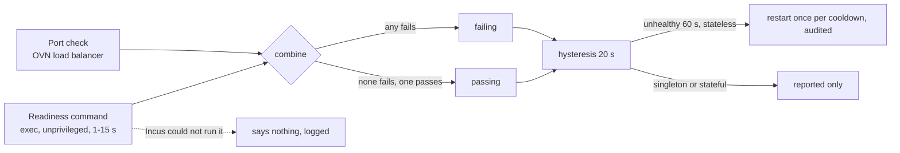

Status: **slice 1 built (2026-10-21): MOCK VERIFIED and CONTRACT VERIFIED; not yet REAL INCUS TESTED.** Related: [mobility and HA](mobility-and-ha.md), [replica-unhealthy runbook](../runbooks/replica-unhealthy.md), `apelora_domain::readiness`.

## The gap

Health was decided from Incus's status and the OVN load balancer's probe of each service port, which is a TCP connection. An application that accepts connections but cannot serve (a database stuck in recovery, a web server whose workers hang) passes it, and a stateless replica in that state keeps getting traffic and is never restarted.

## What a person declares

A module can carry a **readiness command**: a program and its arguments that Apelora runs inside each instance of the module; exit status 0 means ready. It is set per module in the Studio (Properties → Application check) or by a class's runtime (`runtime.readiness`), and travels as `readiness: { command, timeoutSecs }` in the module's desired state.

Rules, enforced by the schema in the Studio and again by the control plane (`DesiredModule::validate`):
- an argument list, **never a shell line**: the program is a name or path (`A-Za-z0-9_./+-`), at most 8 arguments of at most 200 characters, no control characters, and the program may not be a shell (`sh`, `bash`, `dash`, `ash`, `zsh`, `ksh`, `csh`, `tcsh`, `fish`, `busybox`), so an argument list cannot become a script;
- a time limit of 1 to 15 seconds (default 5); longer counts as failing (the exec waits no longer than Incus's request limit);
- only the exit status is read. The output is discarded and not recorded in the instance.

## How it is run

The deployment worker's health supervision, once per pass and only on the supervisor's leader lease:
- picks each running, reachable, Apelora-owned instance of a module that has a command, at most eight at a time;
- asks Incus to run it without a terminal (`POST /1.0/instances/<name>/exec`, `interactive: false`, `record-output: false`) as the numeric user `APELORA_PROBE_UID` (default 65534, never root unless set to 0, which is logged) in `/`, and waits for the operation; a command still running at the limit is cancelled and counts as failing;
- turns the result into a probe (`probe_of_run`): exit 0 passes, any other exit or a timeout fails, and **a command Incus could not run says nothing** and is logged, so a misdeclared command cannot restart healthy replicas;
- combines it with the port check (`combine`): any failure fails the instance; otherwise any pass passes it, so an instance without a service address (a database) is judged by its command alone.

The result goes through the same hysteresis as the port check (unhealthy after failing 20 s, healthy after passing 20 s). The recorded detail says which check failed: *port check failing*, *readiness command failing*, *port check and readiness command failing*, and so on. A stateless replica that stays unhealthy for 60 s is restarted, once per cooldown, and audited, exactly as before; singleton and stateful modules are reported, never restarted.

## Why a command inside the instance

The alternatives were weighed and rejected for now:
- **HTTP from the worker:** application networks are isolated and deny by default; the worker has no route in, and opening one for probing would weaken the isolation the connections design provides.
- **A prober instance on each application network:** a new thing to deploy, allow and keep alive per application. Possible later if exec into tenant instances proves unacceptable.
- **OVN's own checks:** TCP only.

Running a command inside a tenant's own instance is within what the person who deploys it already controls (they choose the image and its configuration), the user is unprivileged, the command comes from their own design, and nothing is returned except an exit status. It does need the program to exist in the image.

## What is not claimed

- Not run against a real Incus: the exec call and the operation's `return` value follow Incus's documented exec API and are tested against a fixture of it; the restricted deploy identity's right to exec in its project is unverified.
- No catalog class declares a command yet. A class that gets one must be checked on the lab with its real image (for example that `pg_isready` is on the PATH of the PostgreSQL image).
- Output is not read, so a check cannot say why it failed; look in the instance.
- Health trackers still live in the worker's memory and start over after a restart.
