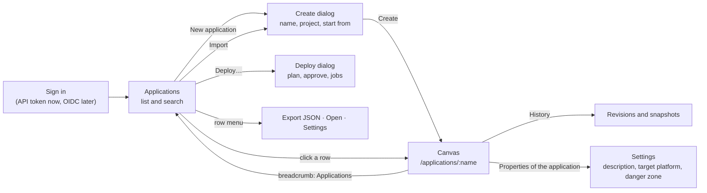
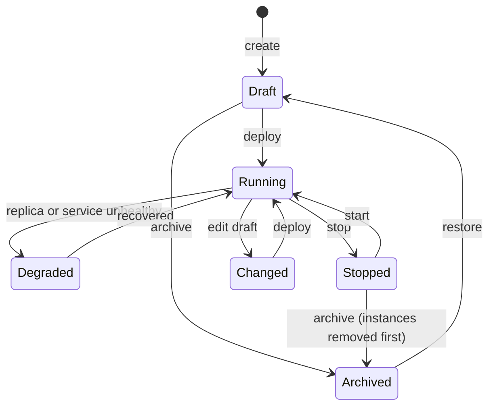
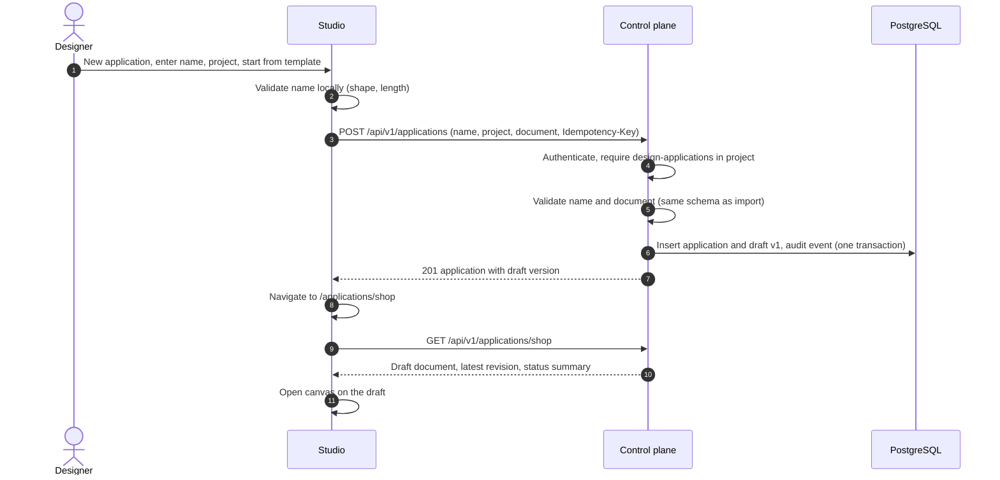

Status: **built** (control plane API and Studio; MOCK VERIFIED and stubbed-API tests, Start, Restart, Shut down, Stop and Migrate REAL INCUS TESTED at the worker on 2026-10-21, ADR 0015). Routes are `/studio/applications[/:name[/:tab]]` and the Assembly Library stays at `/` · Date: 2026-10-20 · Extends [application deployment](application-deployment.md) · Roles: [access and roles](../architecture/ACCESS-AND-ROLES.md) · Storage: [storage](../architecture/STORAGE.md)

## 1. Problem

Today the Studio opens straight onto one diagram kept in the browser (`localStorage`). The control plane learns an application exists only when it is first deployed (`ApplicationInfo` has just a name, a creation time and a latest revision number). There is no place to see all applications, create one on purpose, choose where it lives, return to it later from another machine, or see what is running at a glance.

**Goal.** A designer lands on an **Applications** view, creates an application (or opens an existing one), and the canvas opens on that application. The canvas, deploy dialog and live overlay already built keep working unchanged on the opened application.

**Non-goals (now).** Multi-user live co-editing; cross-application dependencies; marketplace sharing; changing an application's name after creation (instance names derive from it).

## 2. Navigation

Deploying is not done from the canvas. Leaving it (the breadcrumb, or the Applications link of the Assembly Library) lands on the list, where each application has Deploy…, Start, Restart, Stop and the rest of its lifecycle. The canvas saves by itself (the Assembly Library in this browser a moment after each change and when the page is left; an application's draft on the server, shown as "All changes saved"). The design's name is edited by double-clicking it; an application's own name is fixed because its instances are named after it. **Import** on the list creates an application from an exported `.assembly.json` (validated like any import, the name chosen before it is created); **Export JSON** in a row's menu saves its draft, or its latest version, as that file. Header chips and messages say "cluster", never the name of the runtime.

The canvas is not a separate product: it is the existing Studio workspace bound to one application. Routes use the path `/applications` (list) and `/applications/:name` (canvas) so a link opens the right application.

## 3. The Applications view

Layout follows the Studio design contract (white shell, light-gray framed content, daisyUI tokens, one primary button per toolbar, no gradients).

| Area | Content |
|---|---|
| Toolbar | Search, filters (project, status), **New application** (the one primary button) |
| Table or cards | Name · project · status · modules · replicas running · last revision · last edited by and when |
| Row menu | Open · Duplicate · Export JSON · Archive (needs permission) |
| Empty state | "No applications yet" with **New application** and **Start from a template** |
| Footer line | Counts per status; shows "Mock data" until the API is a real backend |

Status, derived and never typed by a person:

| Status | Meaning | Source |
|---|---|---|
| **Draft** | Designed, never deployed | No revision deployed |
| **Running** | All deployable modules ready | `GET /applications/{name}/status` |
| **Degraded** | Some replicas or services unhealthy | Same, with health evidence |
| **Stopped** | Instances exist, none running | Same |
| **Changed** | The draft differs from the deployed revision | Compare draft with latest revision |
| **Archived** | Hidden from the list; data retained | Application record |

## 4. Creating an application

The dialog asks for the least that is needed.

| Field | Rule |
|---|---|
| **Name** | Lowercase letters, digits and `-`, starts with a letter; at most 40 characters, because instances are named `<application>-<module id>` (63-character limit). Unique within the platform. **Cannot be changed later**; "Duplicate" is the way to a new name. |
| **Project** | Chosen from the projects the signed-in identity may design in (`whoami`). Defaults to the only one. Decides where it can be deployed. |
| **Start from** | *Blank canvas* · *Template* (the nine starters) · *Import file* (assembly JSON) · *Docker Compose* · *Duplicate of…* |
| **Description** | Optional, 200 characters. |
| **Design target** | The runtime provider (Incus by default; see [providers](../architecture/HYPERVISOR-PROVIDERS.md)). |

On **Create** the control plane records the application and its first draft, then the Studio navigates to the canvas. Errors (name taken, no permission, invalid file) are shown in the dialog; nothing is created on failure.

## 5. Drafts, revisions and the local copy

| Thing | What it is | Mutable |
|---|---|---|
| **Draft** | The working document of an application, stored on the server with a version number | Yes |
| **Revision** | Immutable copy saved when a deployment is requested (exists today) | No |
| **Local copy** | The browser's cache (`localStorage`), used for instant load and offline editing | Yes, never authoritative |
| **Snapshot** | Named restore point (exists locally in the Studio; later stored with the application) | No |

Autosave sends the draft after a short pause with `If-Match: <version>`. If another session saved first the server answers **409**; the Studio shows a *compare and choose* dialog (reusing the snapshot comparison): keep mine, take theirs, or save mine as a duplicate. Import is untrusted input exactly as today: validate, never replace the current draft on failure.

## 6. API additions (PROPOSED)

All under `/api/v1`, documented in the OpenAPI document, regenerated into `@apelora/api-client`.

| Method and path | Permission (scope: project) | Purpose |
|---|---|---|
| `POST /applications` | `design-applications` | Create application and first draft; `Idempotency-Key` |
| `GET /applications` | read | List with summary: project, status, counts, last editor (extends today's `ApplicationInfo`) |
| `GET /applications/{name}` | read | Application, draft (with version), latest revision, status summary |
| `PUT /applications/{name}/draft` | `design-applications` | Save draft; `If-Match` required; 409 on conflict |
| `GET /applications/{name}/revisions` | read | Immutable revisions with who and when |
| `POST /applications/{name}/duplicate` | `design-applications` | New name, same draft |
| `POST /applications/{name}/archive` | `deploy` | Only when no instances remain, or after removal is queued |
| `POST /applications/{name}/restore` | `deploy` | Back to Draft |

Existing `plan`, `deployments` and `status` routes stay; deploying an application that was never created is refused with a clear message pointing to *New application*. Every write is audited (`application.create`, `application.draft.save`, `application.archive`, …) without document contents.

## 7. Roles in this view

| Action | admin | operator | designer | auditor | viewer (proposed) |
|---|:-:|:-:|:-:|:-:|:-:|
| See the list and status | ✓ | ✓ | ✓ | ✓ | ✓ |
| Open the canvas read-only | ✓ | ✓ | ✓ | ✓ | ✓ |
| Create, edit, duplicate | ✓ | ✓ | ✓ | — | — |
| Deploy, archive, restore | ✓ | ✓ | — | — | — |
| Change infrastructure from here | never | never | never | never | never |

When the signed-in identity cannot edit, the canvas opens read-only: the toolbar edit controls are disabled and a banner says why. The server enforces it either way.

## 8. Studio changes

- Add path routing (a small router; `/applications`, `/applications/:name`). The header breadcrumb becomes *Applications / name*.
- New feature folder `features/applications` (list state, create dialog, API calls); the existing editor store is created per opened application and given the loaded draft.
- Persistence layer: `loadAssembly`/`saveAssembly` become "draft sync" with the local copy as a cache and a visible save state (*Saved*, *Saving…*, *Offline*, *Conflict*).
- Fabric Console's remaining Phase 05 item, an applications view with health, uses the same API with an operator emphasis (fleet-wide status, jobs, replicas) rather than design.

## 9. Failure handling

| Failure | Behaviour |
|---|---|
| Name taken | Dialog error on the name field; nothing created |
| Create succeeds, navigation fails | The application appears in the list; opening it works |
| Save conflict | 409 → compare dialog; never silent overwrite |
| API unreachable while editing | Keep editing locally, state *Offline*; sync and conflict-check on return |
| Draft invalid on the server | Rejected with the schema errors; the local copy is kept |
| Archive with instances still present | Refused with the list of instances; offer *Remove instances first* (typed-name confirmation) |
| Opening an application the identity cannot see | 404 (not 403), so names do not leak |

## 10. Tests

- Server: create/list/open/save/conflict/duplicate/archive with every role; a designer in project A cannot read or write project B; idempotent create; invalid names; revision immutability.
- Studio (Playwright, stubbed API first): empty state; create from blank and from template; name validation; open from the list and by URL; breadcrumb back; read-only canvas for an auditor; conflict dialog; offline banner.
- Real browser against the test cluster: create, design, deploy, return to the list and see *Running*.

## 11. Build order

1. API: applications table gets project, description, archived flag; `drafts` table with version; `POST /applications`, `GET /applications/{name}`, `PUT …/draft`; tests.
2. Studio: router, Applications list, create dialog (blank first), open canvas on a draft, autosave with `If-Match`.
3. Templates, import and Compose in the create dialog; duplicate; export.
4. Status column from the status API; filters; read-only canvas for roles without edit.
5. Archive and restore; conflict dialog; revisions list.
6. Console applications view (operator emphasis).
