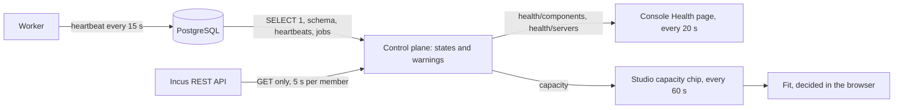

Status: **built (first slice)** · Date: 2026-10-21 · Related: [observability skill](../../.agents/skills/observability/SKILL.md), [troubleshooting runbook](../runbooks/troubleshooting.md), [Health page runbook](../runbooks/health-page.md)

## 1. Problem and scope

An operator needs one place that answers "is Apelora working, and if not, which part and why?", and a designer needs to know, while drawing, whether the cluster has room for the design. Today the Console's Overview shows only whether the control plane and Incus answer, and the Studio says nothing about resources.

**Goals**

- A **Health** page in the Fabric Console: one row per component with its state in words, when it was checked and, when it is not healthy, the reason and the next step. It refreshes while visible and says how old its data is.
- A **Servers** section on the same page: per server ("minion", an Incus cluster member) its status, roles, CPU threads and load, memory used of total, each storage pool used of total, the instances running there, and warnings.
- A small **Capacity** indicator in the Studio: what the design asks for next to what the cluster has free, and whether it fits on one server or across servers.

**Non-goals (cut, with reasons)**

- *Time series, charts and alert delivery.* They need a metrics store (Prometheus-style scraping, retention). The page shows the present; trends are a later slice when metrics are exported.
- *Per-instance CPU and memory usage.* Incus reports it per instance (`/1.0/instances/{name}/state`), but that is one request per instance per refresh; it belongs to an instance detail view, not a cluster overview.
- *Disk I/O, network throughput, temperatures, hardware faults.* Not in the Incus endpoints read here; hardware belongs to the bare-metal slice.
- *Actively probing identity providers on each refresh.* The page reports the control plane's own last result (it retries unreachable providers every minute), so a refresh never sends traffic to the provider.
- *Reserving capacity.* Incus does not reserve CPU or memory for limits, so "fits" is advice, never a promise; the deploy itself decides.

**Users and scale.** A handful of operators per installation; 1–20 servers today, ~100 later. A refresh every 20 s per open Health page, and every 60 s for the Studio's capacity chip.

**Constraints.** Incus only through its REST API (read-only GETs here); every number comes from Incus, PostgreSQL or the services; mock data is labelled; names are original.

## 2. What each component shows, and why

The rule for every row: **state in words** (Healthy, Degraded, Down, Unknown, Not set up) with a dot that never carries the meaning alone; **one line of facts**; **the reason and a next step** when it is not healthy. "Unknown" is used whenever something could not be observed; nothing is guessed.

| Component | Facts shown | Healthy when | Degraded / Down when | Source |
|---|---|---|---|---|
| Control plane | version, API version, uptime, start time, sign-in mode, inventory source (mock or Incus) | it answers (the page itself is the proof) | development mode (sign-in off) is Degraded | the process |
| Database | reachable, round-trip time of `SELECT 1`, schema version applied vs expected | reachable and schema current | round trip > 500 ms (Degraded); unreachable or schema behind (Down) | PostgreSQL, `_sqlx_migrations` |
| Deployment workers | each worker's id, host, version, started, last heartbeat | at least one heartbeat within 45 s | none live (Down: nothing is deployed, moved or recovered); a worker lost in the last 10 minutes (Degraded) | `worker_heartbeats` (new) |
| Job queue | waiting, waiting to retry, running, stalled (lease expired), failed in the last hour, age of the oldest waiting job | nothing old, stalled or failed | jobs wait and no worker runs (Down); oldest waiting > 2 min, stalled jobs, failures in the last hour (Degraded) | `jobs` |
| Incus | reachable, server and API version, clustered, members by status, round-trip time | reachable, every member Online | any member not Online (Degraded); unreachable (Down) | `GET /1.0`, `/1.0/cluster/members` |
| Networks | count, managed, which are not `Created`, members missing a non-OVN network | all created everywhere | any errored or missing on a member (Degraded) | `/1.0/networks` |
| Storage pools | count, which are not `Created`, members missing a pool | all created everywhere | any errored or missing (Degraded) | `/1.0/storage-pools` |
| Identity providers | each provider: enabled, reachable at the last check, the error; API tokens on/off | every enabled provider reachable | an enabled one unreachable (Degraded); none set up is "Not set up", not an error | the control plane's sign-in runtime (read-only) |

**Servers** (one card each): Incus status and message, roles, architecture, failure domain, whether automatic placement is held, uptime; CPU threads with the 1/5/15-minute load; memory used of total; every storage pool's used of total; the instances there (running / total, and a list in the detail dialog). Warnings are decided by the server, not the browser: status not Online; memory above 90 %; a pool above 85 %; 1-minute load above the thread count; resources not readable (with the reason). Bars always show *used of total* in bytes, never a percentage without its base.

**Why one Health page, not an upgraded Overview.** The Overview works before sign-in and for every role (it uses only the public `/health`), and it is where a broken connection is explained. The Health page needs `cluster.view`, refreshes on its own and reads several sources; keeping it separate keeps the Overview fast and the sign-in path simple. The Health page is the second navigation entry.

**Studio capacity.** A chip in the Studio header: "Capacity: fits on one server", "fits across servers", "does not fit" or "unknown". Its popover lists what the design asks for (vCPU and memory per instance times replicas, volume sizes) and what is free (sum and per server). Fit is decided by a pure function (`packages/assembly-model/src/capacity.ts`): memory and volume space are hard limits (a shared volume pool, such as clustered LVM or Ceph, is one budget, not one per server); a single instance cannot have more vCPUs than a server has threads; total vCPUs above the threads is shown as sharing, not as a failure (Incus shares CPU time). Root disks are not counted (image sizes are unknown before deployment), and the popover says so. Without a control plane it says "Capacity unknown: this browser is not connected to a control plane."

## 3. Contracts

| Method and path | Permission | Returns |
|---|---|---|
| `GET /api/v1/health/components` | `cluster.view` (platform) | `HealthReport`: overall state, checked time and one object per component above |
| `GET /api/v1/health/servers` | `cluster.view` (platform) | `HealthServers`: source (mock/Incus) and one `HealthServer` per member (or the standalone server) |
| `GET /api/v1/capacity` | `cluster.view` (platform, server names shown) or `capacity.view` (any scope, servers numbered, no names) | `CapacityReport`: per server whether it accepts new modules, CPU threads, load, memory free/total, volume-pool space free/total; totals |

`capacity.view` is a new **tenant** permission (floor: application) held by Application designer, Application operator, Project administrator, Organisation owner and Viewer. Designers do not hold `cluster.view` (an infrastructure permission granted only at platform level), so without it the Studio could not show capacity to the people drawing designs. It reveals free totals only: no server names, addresses or instances.

**Data model.** Migration `0016_worker_heartbeats.sql`: `worker_heartbeats (id text primary key, host, version, started_at, last_seen, stopped_at)`. The worker writes it at start, every 15 s from its own task (so a long job does not make it look dead), and marks `stopped_at` on a clean shutdown. Rows unseen for a day are deleted at worker start.

**Incus reads (all GET).** Per member: `/1.0/resources?target=<m>` (CPU threads, memory total/used) and `/1.0/cluster/members/<m>/state` (load averages, uptime, per-pool space). A standalone server: `/1.0/resources` and `/1.0/storage-pools/
/resources`. Each member is read concurrently with a 5 s budget; an offline member's resources are "unavailable" with the reason, never zero. The restricted deploy identity can read these (REAL INCUS TESTED, see §5).

Where the data comes from (each request reads its sources afresh; pages read only while visible):

## 4. Failure handling

| Failure | What the page shows |
|---|---|
| Incus unreachable | Incus row Down with the adapter's message; Networks, Storage pools Unknown; Servers section shows the error with Try again |
| One member offline | That server card: status Offline, resources "unavailable: …"; others normal |
| Database down | Database Down, Workers and Job queue Unknown ("needs the database") |
| Development mode (no database) | Database "Not set up", workers/queue Unknown, control plane Degraded (sign-in off) |
| A refresh fails after data was shown | The last data stays, marked with its age, and a notice says the refresh failed and why |
| A slow Incus | Each member read is capped at 5 s, so the page answers within ~5 s |

**Load.** One page refresh = 2 + 2 × members Incus GETs and three small SQL queries. At 20 servers and 5 open pages every 20 s that is ~10 requests/s against Incus, acceptable; past that, cache the server read for 10 s in the control plane (trigger: Incus request latency in debug logs).

## 5. Evidence

- Unit tests: state rules (`apelora_domain::capacity`), heartbeats and queue counts (PostgreSQL), API (mock provider, permissions), fit function (vitest), Playwright with stubbed API (healthy, degraded, loading, error, phone width, axe).
- Lab (REAL INCUS TESTED, read-only, 2026-10-21, four members, Incus 7.0.1): the restricted identity may read `/1.0/resources?target=…` and `/1.0/cluster/members/…/state`; the API's CPU, memory and pool figures equal direct reads; the test cluster's `shared` pool (clustered LVM) is reported once in capacity totals. The instance list per server covers only the projects Apelora's identity may see.

## 6. Next steps

1. Export Prometheus metrics (queue depth, heartbeat age, Incus latency) and alert on symptoms; link alerts to runbooks.
2. Per-instance usage in an instance detail view.
3. Cache the server read when installations grow (see Load).
