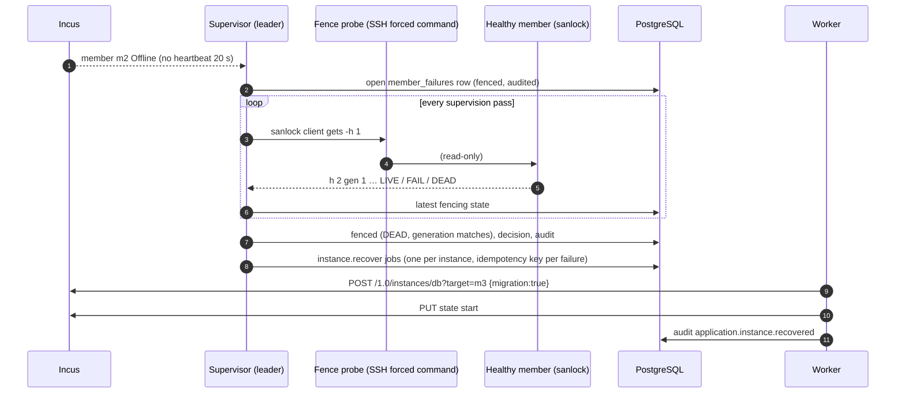

Status: **agreed; slices A and B built (see §3a, §3c for evidence). Slice C is Apelora's own spread, MOCK VERIFIED 2026-10-22, not run on the lab** · Date: 2026-10-22 · Related: [platform architecture §7](../architecture/PLATFORM-ARCHITECTURE.md), [storage](../architecture/STORAGE.md), [storage options](../assets/diagrams/storage-options.svg), [member failure](../runbooks/member-failure.md)

## 1. What Incus does, measured on the test cluster (Incus 7.0.1, four members, btrfs local pools)

| Case | Result | Evidence |
|---|---|---|
| Move a running VM (`migration.stateful=true`) to another member | Moves running; the disk on the local pool is copied, then memory. Boot time unchanged; longest pause of a 0.1 s ticker inside: **0.80 s** | REAL INCUS TESTED, 2026-10-21 |
| Evacuate the VM's member with `cluster.evacuate=live-migrate`; restore | Moved running to another member and back; longest pause **0.29 s**; no reboot | REAL INCUS TESTED, 2026-10-21 |
| Container | No live move (needs CRIU): it stops, moves and starts | Incus documentation |
| Instance with an attached custom volume on a member-local pool | The volume does not follow (unless marked `dependent`, which ties its life to the instance); evacuation stops the instance in place | REAL INCUS TESTED (containers), Incus documentation (VMs) |
| A member fails | Its instances stop. Incus can restart those on **shared** storage elsewhere (`cluster.healing_threshold`), and warns that it must be sure the member is really off (fencing), or two copies may write the same disk. Apelora does it per instance after fencing (§3b): a container on `lvmcluster` ran again on another member 144–155 s after its member's VM was force-stopped | Incus documentation; REAL INCUS TESTED, 2026-10-21 (§3c) |
| Load balancing | Incus can live-migrate VMs to the least loaded member (`cluster.rebalance.*`) | Incus documentation |

The restricted deploy identity may not choose a member for an instance unless the project allows it (`restricted.cluster.target=allow`).

## 2. What each workload gets

| Workload | Planned move (maintenance, rebalancing) | Unplanned failure |
|---|---|---|
| Stateless replicas behind a service address | Replace, then retire (built) | Other replicas keep serving; the lost one is replaced (built, REAL INCUS TESTED) |
| VM without local data volumes, live migration on | **Moves running, under a second** (slice A) | Restarts elsewhere only on shared storage, after fencing (slice B) |
| Container, or VM with `data-local` volumes | Stop, copy the volumes to the new member, move, start: a short stop (slice A) | Waits for its member, or is restored from a backup on another member |
| Anything on a shared pool (SAN with clustered LVM, distributed storage) | Moves without copying | Restarts on another member once the failed one is fenced (slice B) |

No interruption at all through a failure needs more than one copy running: replicas for stateless modules, the application's own replication for databases.

## 3. Slices

**A. Moves.** A module can ask for live migration (VMs only; refused together with `data-local` volumes, which cannot follow it). Apelora then sets `migration.stateful=true` and `cluster.evacuate=live-migrate`, so evacuations move it running. A *Move…* action (dry run first) moves one instance to a chosen member: live when it can, otherwise only when the person allows a short stop, copying its volumes to the new member and deleting the old copies once it runs there. The move is a worker job (`instance.move`) so a crash resumes it; it needs `restricted.cluster.target=allow` on the project.

**B. Failure recovery on shared storage, with fencing.** Shared pools (clustered LVM on a SAN, or distributed storage) back the `data-replicated` class. Apelora restarts a failed server's modules from a shared pool on another server only once that server is fenced: its storage lease is dead (sanlock, read on a healthy server), or a person confirmed it is off (typed name, approval); a BMC fence provider can be added later. Incus's own healing stays off. This applies to every Apelora instance whose disks are all on a shared pool, container or VM, and to nothing on a member-local pool. Design: §3b; decision: ADR 0013.

**C. Rebalancing.** Apelora plans the spread. It does not turn on Incus `cluster.rebalance.interval` (that setting stays warned against, and at 0). For a stateless module with two or more replicas on one Online member, the plan moves one (the highest name) to the least-loaded eligible member (Online, not held, same architecture). A VM is planned live; a container stops briefly. The members report always shows the dry run. The supervisor queues at most one `instance.move` per pass, and only when `APELORA_REBALANCE=1`. REAL INCUS TESTED (four members, 2026-10-22, three runs of `replicas_sharing_a_member_are_spread_by_the_rebalancer`): with both container replicas on `apelora-test-1`, one pass queued one audited move of `-r2`, which was Running on `apelora-test-2` 3.5–3.8 s later; the next pass queued nothing. The VM (live) path of the spreader is MOCK VERIFIED; live moves themselves are tested by the move test.

## 3a. Slice A as built

- `apelora_domain::mobility::plan_move` decides live or stopped, what is copied and what blocks it (not Apelora's, the same member, not Online, another architecture, a stop not allowed).
- `GET|POST /api/v1/instances/{project}/{name}/move` (dry run; request with the name typed and `allowStop`), needs `instance.manage`; queues `instance.move`, audited.
- The worker's `instance.move` job re-reads the instance at every step: live move, or stop → copy volumes to the target member → move → start → delete the old copies and record the volumes' new member. A failed copy or move starts it again where it was.
- Studio: *Keep running when moved* for VM modules (refused with `data-local` volumes); the request sets `migration.stateful=true` and `cluster.evacuate=live-migrate`. Fabric Console: *Move…* on Apelora's instances.
- REAL INCUS TESTED (2026-10-21): `instances_move_with_their_volumes_and_vms_move_live`; from the console in a real browser, a VM module moved running from member 1 to member 2 with a longest pause of 0.26 s and no reboot.

## 3b. Slice B: restart on another server after fencing (design)

Decision record: [ADR 0013](../adr/0013-fencing-before-restart.md). Built 2026-10-21; evidence in §3c.

**Scope.** After a server fails, Apelora restarts its stateful modules whose disks are all on a shared pool on another server, once the failed server is fenced. Out of scope: planned moves (slice A), stateless replicas (substitutes, built), member-local data (waits, or a restore), Ceph-specific fencing, BMC fence providers, failback.

**Who decides what.**

| Concern | Owner |
|---|---|
| Member offline (heartbeats) | Incus (`cluster.offline_threshold`, 20 s) |
| Whether the failed server can still write | sanlock's host lease (and its watchdog), read by Apelora; or a person |
| Which instances may restart elsewhere | Apelora: deployment record, class `data-replicated` (root disk and volumes on the shared pool) |
| Where it restarts | Apelora names an Online member; Incus's placement scriptlet may refuse |
| Relinking and starting | Incus (`POST /1.0/instances/<name>?target=` with `migration: true`, then `start`) |

**Policy.** A module restarts elsewhere when every volume it has is `data-replicated` (at least one): the control plane resolves the class to the shared pool (`APELORA_SHARED_POOL`, which must exist in Incus with driver `lvmcluster` or `ceph`) and puts the module's root disk there too (`InstanceSpec.rootPool`, never set by a caller). A module mixing `data-local` and `data-replicated` volumes is refused. Stateless modules still cannot have volumes. Everything else on a failed server waits, and Servers → Members says why: "root disk on the member's own pool", "volume data on member-local pool local: waits for the server or a restore", "not created by Apelora".

**Fencing state machine (per failure).**

| State | Means | Next |
|---|---|---|
| `waiting` | Offline, not fenced; the reason says why (lease still LIVE/FAIL; no fresh reading; lease never seen while Online; generation changed; no probe) | Lease DEAD → `fenced`; a person confirms → `fenced`; member Online → closed |
| `fenced` | Evidence recorded (kind, who observed, host id, generation, when; or who confirmed) | Decision recorded once, jobs queued |
| closed | Member Online again (`resolved_at`) | Mapping re-learned; a new failure opens a new row |

**Data (migration 0028).** `member_failures` (one open row per member: detected, Incus's last heartbeat, latest fencing state, fenced at and evidence, confirmation, decided at and decision, resolved at) and `member_lock_hosts` (member → lockspace, host id, generation, seen at; learned from each member's own lockspace line while it is Online).

**Contracts.** `GET /api/v1/cluster/recovery` (`cluster.view`): per failed member its fencing state, reason and next step, and per instance whether it restarts (and on which member) or waits (and why). `POST /api/v1/cluster/members/{member}/fencing` (`cluster.fence_confirm`, approval, typed name): a person confirms the server is off; refused unless Incus reports it Offline. Job `instance.recover` (`{project, name, application, module, failedMember, failure}`).

**The job, step by step** (each step re-reads Incus, so a reclaimed or retried job continues):
1. Instance gone → rejected. On another Online member and running → done.
2. Still on the failed member: the failure must still be open and fenced, and the member still Offline (else rejected: nothing changes). Safe point (a cancellation stops here, nothing changed). Choose the member (§ ADR decision 5), relink (recorded Incus operation).
3. On the new member, stopped: ownership marker checked (`user.apelora.managed`, readable again), start (recorded operation).
4. Running there: audit `application.instance.recovered` with the failure, the evidence kind and the seconds since the failure was detected.

**Failure handling.**

| Failure | Behaviour |
|---|---|
| Probe unreachable, refused or slow (10 s) | No fresh reading: `waiting`; counted in `apelora_fence_probes{outcome="failed"}` |
| The failed server is partitioned but reaches the SAN | Lease stays LIVE: `waiting` forever; alert `member-unfenced` after 5 min; a person decides |
| Failed server returns before fencing | Row closed; nothing was changed |
| Failed server returns after relinking | Its instance records now point elsewhere; Incus does not start them there. The lockspace is rejoined at boot |
| Relink refused (scriptlet, target offline) | Attempt fails, retried with back-off; the next attempt chooses again |
| Start refused (lock still held: this member's sanlock does not see the host dead yet) | The job waits (5 s steps, no attempt used) for up to 120 s after fencing, then fails and is retried; data cannot be written twice |
| Worker dies mid-job | Lease expires, another worker resumes from the observed state |
| Supervisor leader changes | The decision is in the row; jobs have idempotency keys: no second decision |

**Observability.** Logs `recovery: …` (member, failure, evidence, instance). Metrics `apelora_member_failures{state}`, `apelora_fence_probes{outcome}`, `apelora_recoveries{outcome}`. Alert `member-unfenced` ("A failed server is waiting for fencing", 300 s). Audit `cluster.member.failed`, `cluster.member.fenced`, `cluster.member.fence.confirmed`, `application.instance.recover`, `application.instance.recovered`.

**Security.** The probe key can only run one read-only command as an unprivileged account; host keys are pinned; nothing secret is stored in the database or logged. Confirmation is a protected action (approval). The worker still uses only the restricted deploy identity (`restricted.cluster.target=allow` lets it name the member).

## 3c. Slice B as built (2026-10-21)

- Domain: `apelora_domain::fencing` (sanlock output parser, `learn`, `decide`, Incus heartbeat time), `apelora_domain::recovery` (`plan_recovery`, `choose_target`, `blocked_by_storage`), `storage::VolumeClass::DataReplicated`, `InstanceSpec.rootPool`.
- Persistence: `member_failures`, `member_lock_hosts` (migration 0028), `apelora_persistence::recovery`.
- Worker: `fencing.rs` (SSH probe), `recovery.rs` (supervisor step and the `instance.recover` job), metrics, alert rule `member-unfenced`.
- API: `GET /api/v1/cluster/recovery`, `POST /api/v1/cluster/members/{member}/fencing` (`cluster.fence_confirm`, approval); the control plane resolves `data-replicated` to `APELORA_SHARED_POOL`; the Health page's Incus row says whether each failed server is fenced.
- Console: Servers → Members, *Failed servers*: fencing state, the reason or the evidence, per instance *Restarts on …* or *Waits for its server* with why, *Confirm powered off…* (typed name).
- Evidence: MOCK VERIFIED (worker, API, Console with a stubbed API and axe); REAL INCUS TESTED: `shared_pool_instances_keep_their_disks_on_it_and_move_without_copying`, three container `ha-drill.sh` runs and three VM runs (`HA_DRILL_VM=1`, 2026-10-23; timeline in the [runbook](../runbooks/member-failure.md#modules-on-shared-storage)). Not drilled: a partitioned (not stopped) member, and the confirmation path against the lab.
- Open: the Studio cannot choose `data-replicated` yet (the API accepts it); a BMC fence provider; Ceph-specific evidence; fencing as soon as any healthy observer (whose own lease is LIVE) reports DEAD, instead of the freshest reading only (run 3 fenced 9 s after member 1 saw DEAD).

## 4. Failure handling of a move

| Failure during a move | Behaviour |
|---|---|
| The copy of a volume fails | The instance is started again where it was; the partial copy is deleted |
| The instance move fails | The old volumes are still there; the instance is started where it was |
| The worker stops half way | The job is resumed: it reads where the instance and the volumes are, and continues |
| The instance does not start on the new member | The old volumes are kept; the job fails and says so; the runbook moves it back |

Old volumes are deleted only after the instance runs on the new member.
