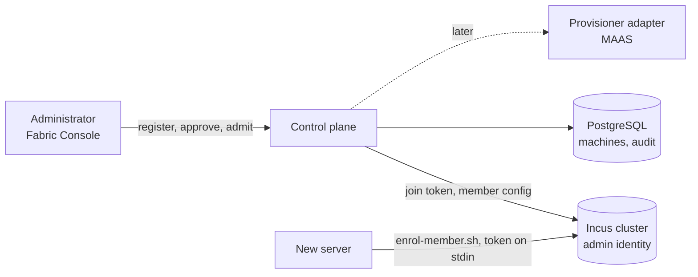

Status: agreed (follows [ADR 0002](../adr/0002-bare-metal-provisioning-maas.md), accepted) · Date: 2026-10-20

## 1. Problem and scope

A new server must go from "known to the administrator" to "Incus member that Apelora places
modules on", the same way whatever installed it, with an administrator approving every step
that changes something, and every step audited.

- **Goals (slice 1):** machine records with a provider; the **manual** provider (operating
  system installed by hand); approval issuing a single-use join token; an enrolment script for
  the host; a new member held from placement until Apelora has validated it; admission making it
  eligible; Fabric Console views.
- **Later slices:** a MAAS adapter (discovery, commissioning, OS deployment with the enrolment
  cloud-init, power), removing a member from the cluster, a burn-in workload before admission.
- **Non-goals:** writing PXE, DHCP or BMC tooling; storing BMC credentials (they stay in the
  provisioner); placing instances ourselves (Incus places, ADR 0001).
- **Scale:** tens of machines; one administrator acting at a time.

## 2. Design

**Lifecycle** (derived, never stored as a status string: Incus is the truth for membership):

| State | Meaning | Derived from |
|---|---|---|
| `registered` | known to Apelora, not approved | record without approval |
| `approved` | a join token is waiting for the host | approval recorded and Incus lists the pending token |
| `approval-expired` | the token was used up, revoked or expired without a join | approval recorded, no token, no member |
| `held` | joined; Incus does not place instances on it automatically | member with `scheduler.instance=manual` |
| `eligible` | joined and placed on by Incus | member with any other scheduler setting |
| `left` | was admitted, no longer a member | admission recorded, no member |

**Placement gate.** Incus's member setting `scheduler.instance=manual` excludes a member from
automatic placement while still allowing explicitly targeted instances (REAL INCUS TESTED: six
new instances avoided the held member; a targeted one landed on it). Incus cannot preset it
before a member joins, so the enrolment script sets it right after the join; a member that joins
without it is reported (warning "joined without being held") rather than silently trusted.

**Admission** re-reads Incus and checks the member: online; Incus major version and same
version as the cluster; kernel ≥ 6.12; every storage pool and located network created on it;
architecture (a warning for the first member of a new architecture). OVN chassis and clock are
reported as not checked (the Incus API does not show them). Any failure blocks admission;
admission sets `scheduler.instance` back to the default (key removed). The member update sends
the member's roles, groups and failure domain with the config: Incus treats a missing role list
as dropping roles.

**Provisioners.** `ProvisionerKind` (`manual`, `maas`) with `Capabilities` (discovers,
installs, powers). The manual provider can do none of these: the administrator installs the
OS and runs the enrolment script. The MAAS adapter will implement them and deliver the same
script and token through cloud-init; nothing in the lifecycle above changes.

**Contracts:**

| Call | Effect | Audit |
|---|---|---|
| `GET /api/v1/machines` | machines with derived state, member status, next step, warnings | — |
| `POST /api/v1/machines` `{name, provider, description}` | register (a name that is already a member is adopted) | `machine.register` |
| `POST /api/v1/machines/{name}/approve` | join token, shown once (`Cache-Control: no-store`) with the enrolment command | `machine.approve` (no token) |
| `DELETE /api/v1/machines/{name}/approval` | revoke the pending token | `machine.approval.withdraw` |
| `GET /api/v1/machines/{name}/admission` | admission checks (dry run) | — |
| `POST /api/v1/machines/{name}/admit` | checks, then make eligible; 409 when a check fails | `machine.admit` |
| `DELETE /api/v1/machines/{name}` | forget a machine that is not a member | `machine.remove` |
| `GET /api/v1/cluster/members/{member}/removal` | removal check (dry run): what is left on it, blockers, warnings | — |
| `POST /api/v1/cluster/members/{member}/remove` `{confirm}` | remove an evacuated, empty member for good (the machine becomes `left`) | `cluster.member.remove` |

## 3. Failure handling

| Failure | Behaviour |
|---|---|
| Token expires before the host joins | `approval-expired`; approve again |
| Host joins but the script could not hold it | `eligible` with a warning; the administrator can still run the admission checks |
| A check fails | admission refused, nothing changed, the failing checks returned |
| Incus unreachable | 502 like every other Incus call; records unchanged |
| Two administrators approve at once | the second gets 409 (`approval_pending`) |

## 4. Security

Join tokens are never stored, logged or audited (ADR 0003); the approve response is
`no-store`; the enrolment script reads the token from standard input. All mutating calls need
`manage-infrastructure`, the admin identity and the database (audit). BMC credentials are not
stored by Apelora: with a MAAS provider they stay in MAAS ([the adapter](provisioner-maas.md)); the only
place Apelora handles one is the worker's own process environment, for fencing (ADR 0014).
