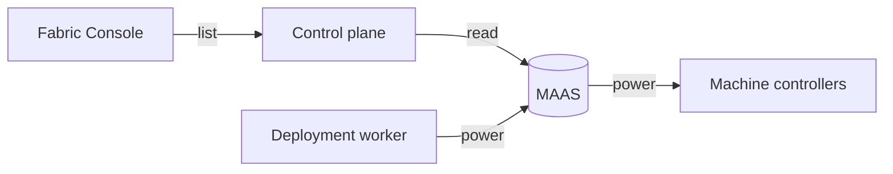

Apelora can use MAAS to find a machine, commission it, install an operating system, run its hardware tests, release it, and switch it off. Apelora does not provide PXE, DHCP, or its own controller for the machine's power. A site that has no MAAS enrols machines by hand, which remains the default.

## What an operator can do

From Fabric Console, with `manage-infrastructure`:

- See the machines MAAS reports, beside the machine Apelora has registered and the Incus member of the same name.
- Register a discovered machine.
- Commission it. Commissioning collects inventory and can run tests. It does not install an operating system.
- Install an operating system. The series name and the cloud-init for enrolment are sent to MAAS. The cloud-init is not stored. The join token is not put in MAAS owner-data, because owner-data is removed when the machine is released.
- Run hardware tests on a machine that is Ready, Broken, or Failed testing. A machine that is allocated or deployed is refused, so a test never loads a member that is in use. The operator types the hostname again. The action is audited, including the test names. Up to 16 named tests or tags may be chosen; otherwise MAAS uses its defaults.
- Release a machine. Disk erasure stays off unless the operator asks for it, and erasure also needs `hardware.delete`. A secure wipe is not offered.

Admission of a machine that came from MAAS checks the hardware-test result. Passed admits the machine. Failed, timed out, aborted, running, or pending blocks it. Degraded, or never tested, warns. If MAAS cannot be reached, that check is skipped.

## How Apelora talks to MAAS

The client is `crates/maas-adapter`. It uses HTTPS, checked against the system trust store or a CA file. Plain HTTP is only for tests on the local machine.

The API key has the form `consumer:token:secret` and is signed the way MAAS expects. It is read from `APELORA_MAAS_API_KEY` when the service starts. It is not logged, stored, returned, or put in an error. The Console never sees it. Give the key a MAAS user that can read machines and power the ones Apelora fences, and nothing else.

The control plane lists machines at `GET /api/v1/provisioners/maas/machines`. The list says when `APELORA_MAAS_URL` is unset or MAAS cannot be reached. It does not return the key or any credential field from MAAS.

## Switching a machine off

A fence mapping names the MAAS machine and its hardware UUID. Before any read or power command, MAAS's record must report that UUID. A wrong identifier is refused.

Power-off counts only when a later read says the machine is off. MAAS accepting the request is not enough. The same limits apply as for every other way of fencing: the member has been offline long enough, fewer than half the members are offline, and a powered-off member is not switched off again during the cooldown.

| What happens | What Apelora does |
|---|---|
| MAAS cannot be reached, or the key is refused | The list shows the reason. No power evidence is recorded. A person can still confirm that the server is off. |
| MAAS has no power reading, as with a machine set to manual power | Not evidence. The member waits. |
| The hardware UUID does not match the mapping | Nothing is changed. |
| The power-off is accepted, but the machine does not read as off in time | The member is not fenced. The attempt is audited. The cooldown blocks a repeat. |

## Limits

Apelora does not change MAAS itself: no image sync, and no management of its zones, pools, tags, or notes. A zone is not a failure domain. A pool is not a role. One MAAS region, for tens to a few hundred machines. The operating-system image for a series must already be present; Apelora does not wait for it. MAAS should keep running if the compute cluster is lost.

## What was checked

On 2026-10-21, listing and reading machines was run against MAAS 3.7.4 in the lab, over HTTPS, with the lab certificate. A wrong key returned 401, an unknown machine returned 404, and a certificate the client does not trust was not used. Those machines use manual power, not a controller. Asking their power state returned 400, and a power-off was accepted but the following read was the same 400, so nothing was fenced. A new machine was Commissioning, with no CPUs, memory, or hardware UUID yet.

Commission, deploy, release, and hardware tests were checked against a server that answers in MAAS's shape: the path, the series name, and cloud-init sent as base64 and kept out of the audit. They have not been run as MAAS installing an operating system, and not on hardware or a real power controller. The hardware-test status was read from the lab (Unknown on its records). A test that boots a machine has not been run.

A certificate marked as a CA is refused. The lab certificate is a leaf.

## See also

[Enrolling a server](node-enrolment.md) · [Bare-metal provisioning](../adr/0002-bare-metal-provisioning-maas.md) · [Fencing by powering off](../adr/0014-bmc-power-off-fencing.md)
