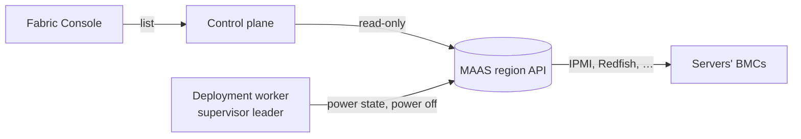

Status: slice 1 agreed and being built · Date: 2026-10-21 · Follows [ADR 0002](../adr/0002-bare-metal-provisioning-maas.md) (accepted) and [node enrolment](node-enrolment.md) · Fencing: [ADR 0014](../adr/0014-bmc-power-off-fencing.md)

## 1. Problem and scope

Operators with real servers want a new machine to be discovered, installed and powered by the tool that already does that (MAAS), and then to join the Incus cluster through the same flow as a hand-installed one. Apelora must not grow its own PXE, DHCP or BMC tooling, and must keep working without MAAS (the **manual** provider stays the default).

- **Slice 1 (this one):** a read-only client of the MAAS REST API in `crates/maas-adapter`; a Console list of the machines MAAS knows (status, power state, architecture, CPUs, memory) next to the machines Apelora has registered; and MAAS as a **fence provider**: the worker asks MAAS for a machine's power state and switches it off through MAAS, so the BMC credentials stay in MAAS, not in Apelora.
- **Later slices:** register a discovered machine in Apelora from the Console; commissioning; deploying an operating system with the enrolment cloud-init (the join token delivered out of band, as ADR 0002 requires); release after removal; burn-in.
- **Non-goals:** writing PXE, DHCP, IPAM or BMC drivers; storing BMC credentials; changing MAAS's own configuration; running MAAS for the operator.
- **Scale:** tens to a few hundred machines; one MAAS region.

## 2. Design

- **Client** (`crates/maas-adapter`): HTTPS only (verified against the system roots or a CA file; no insecure mode, plain HTTP exists only for tests on loopback). Authentication is the OAuth 1.0 `PLAINTEXT` signature MAAS uses with an API key of the form `consumer:token:secret`. The key is read from the environment (`APELORA_MAAS_API_KEY`) when the service starts, never logged, stored or returned, and never appears in an error.
- **What it calls:** `GET /MAAS/api/2.0/machines/` (discovery), `GET …/machines/{system_id}/` (identity and state), `POST …/machines/{system_id}/op-query_power_state` (what the BMC says now), `POST …/machines/{system_id}/op-power_off` with `stop_mode=hard` (fencing). Nothing else.
- **Control plane:** `GET /api/v1/provisioners/maas/machines` lists what MAAS reports with the Apelora machine and Incus member it matches by name. It needs `manage-infrastructure` (the same permission as the machines list), is read-only, and says plainly when MAAS is not configured (`APELORA_MAAS_URL` unset) or unreachable. It never returns the API key or anything from MAAS's credential fields.
- **Fence provider `maas`** (worker, [ADR 0014](../adr/0014-bmc-power-off-fencing.md)): a mapping entry `{ "provider": "maas", "systemId": "…", "uuid": "…" }`. Before anything is read as evidence or sent, MAAS's record of the machine must report the mapped hardware UUID, so a wrong `systemId` refuses instead of vouching for another server. The power-off is confirmed by `op-query_power_state` reading `off` back; MAAS's own answer to the request is not evidence. The same guards as every other provider apply.

## 3. Failure handling

| Failure | Behaviour |
|---|---|
| MAAS unreachable or the key refused | The list says so with the reason; no fencing evidence is produced; the supervisor audits and counts `unreadable`, and a person's confirmation still fences |
| MAAS reports `unknown` power state (a machine with manual power) | Not evidence; the member waits for the lease or a person |
| The machine's hardware UUID differs from the mapping | Refused before any request that changes anything |
| MAAS accepts the power-off but the state does not become `off` within the budget | Not fenced; audited as failed; the cooldown holds repeats back |

## 4. Security

The API key can do whatever its MAAS user can do. Use a dedicated MAAS user that can read machines and power the ones Apelora fences, nothing else. The key lives in the worker's and the control plane's environment (the same secret-store rule as other secrets); the Console never sees it. MAAS runs on management infrastructure that survives the loss of the compute cluster (ADR 0002).

## 5. Evidence

Slice 1 is CONTRACT VERIFIED against a test server that answers in MAAS's documented shapes, and **REAL MAAS TESTED** on 2026-10-21 against MAAS 3.7.4 (snap, region and rack controller) in a Lima VM with TLS (`bash scripts/test-cluster/maas.sh up`, `machines`, `test`; the machines are records with manual power, not hardware):

| Check | Result |
|---|---|
| List and read machines with the OAuth `PLAINTEXT` signature over HTTPS verified against the lab's certificate | Works; a new machine is `Commissioning` with no CPUs, memory or hardware UUID yet |
| A wrong key, an unknown system id, a certificate the client does not trust | 401, 404, and no request is made |
| Power state of a manual-power machine | MAAS answers 400: there is no BMC to ask. The fence provider reads that as unreadable; nothing is fenced |
| Power-off of a manual-power machine | MAAS accepts the request; the read-back that follows is the 400 above, so it is not evidence |
| A server certificate with `CA:TRUE` (what `openssl req -x509` makes by default) | The Rust TLS stack refuses it as a server's certificate although curl accepts it; the lab's certificate is a leaf (`CA:FALSE`) |

Not run against real hardware, with a MAAS-managed BMC (Redfish, IPMI) or with a commissioned machine's hardware UUID; the Console list and registration have been tested against a stubbed API only.
