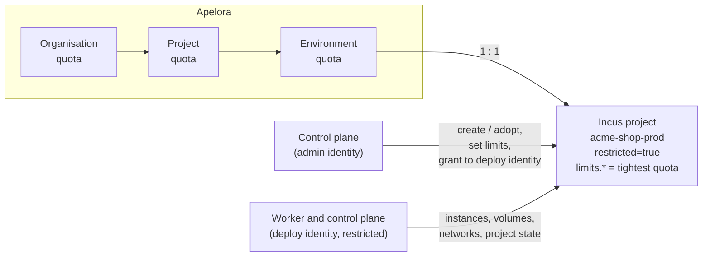

Status: **built (first slice)**; evidence per part in §7 · Date: 2026-10-21 · Decision: [ADR 0012](../adr/0012-tenancy-on-incus-projects.md) · Related: [ADR 0003](../adr/0003-incus-identities-and-cluster-join.md) (two Incus identities), [ADR 0005](../adr/0005-access-model.md) (one restricted Incus project per environment), [identity and authorization](../architecture/IDENTITY-AND-AUTHORIZATION.md), [cloud roadmap](../architecture/CLOUD-ROADMAP.md) principle 4, [Console plan](../development/CONSOLE-PLAN.md) (Tenancy, P1), [runbook](../runbooks/tenancy-quotas.md)

## 1. Problem and scope

Apelora already models organisations → projects → environments, and every environment names the Incus project it deploys into (`<organisation>-<project>-<environment>`, derived by `apelora_auth::backend::incus_project_name`). But nothing created that Incus project: an administrator had to make it by hand, restrict it, and add it to the deploy identity's project list. There were no quotas, so one team could take the whole cluster.

**Goals**

1. **A restricted Incus project per environment**, created by Apelora (or adopted when it already exists), with the documented `restricted.*` keys, its own `default` profile, and the deploy identity allowed to use it.
2. **Quotas** on organisations, projects and environments: instances, CPUs, memory and disk. Stored in Apelora, checked **when a deployment is planned** (a clear refusal before anything is queued), and **mirrored to Incus project limits** so Incus enforces the per-environment ceiling too.
3. **API and Console**: set and view quotas; a Tenancy page under Identity & Access with each environment's Incus project, its restrictions and limit use; plan previews show quota use.

**Non-goals (this slice)**

- Deleting or renaming environments (P2): the Incus project stays when Apelora stops using it.
- Metering and billing (roadmap step 2).
- Quotas on networks, processes, snapshots or per-pool disk (`limits.networks`, `limits.processes`, `limits.disk.pool.*`). The four dimensions are what plans can predict.
- Blocking nested virtualisation for VMs (`restricted.virtual-machines.nesting=block` requires every VM to set `security.nesting=false`; not tried on the lab yet, see §8).

**Scale.** Tens of organisations, hundreds of environments per sector. A quota check reads one Incus project state per environment under the scope (`GET /1.0/projects/<name>/state`, a few milliseconds each), only when a quota applies.

## 2. Mapping onto Incus

- **One environment, one Incus project**, named deterministically (unchanged): `<org>-<project>-<env>`, lowercase, at most 63 characters; tenants cannot choose it; platform administrators (`cluster.manage`) may map an existing project instead. Names in `APELORA_DEPLOY_PROJECTS` and `default` are reserved.
- **Who does what** (ADR 0003 extended by ADR 0012): Incus refuses a restricted certificate every server-level and project-editing call (`internal/server/auth/driver_tls.go`: `ObjectTypeServer` beyond view, `can_edit` on a project, certificates beyond view). So creating a project, changing its configuration and profile, and adding it to the deploy identity's project list are done by the **admin identity, in the control plane only**, synchronously (like join tokens). The worker never gets the admin identity. Reading a project, its state and deploying into it stay with the restricted **deploy identity**.
- **States** of an environment's Incus project (`environments.incus_state`):
  - `pending` — not prepared by Apelora yet (created before this feature, no admin identity configured, or the last attempt failed; `incus_detail` says why);
  - `created` — Apelora created it with the baseline below;
  - `adopted` — it existed; Apelora checked `restricted=true`, granted it and leaves its restrictions as they are (it reports differences from the baseline).
  An existing project that is **not restricted is never adopted**: the environment stays `pending` with that reason.

### 2.1 Baseline configuration of a created project

Every key is from the pinned Incus release's documentation (`doc/config_options.txt`, groups `project-features`, `project-restricted`, `project-limits`, `project-specific`) and was checked against `internal/server/project/permissions.go`:

| Key | Value | Why |
|---|---|---|
| `restricted` | `true` | turns the restrictions on |
| `restricted.containers.nesting` | `block` | no nested Incus |
| `restricted.containers.privilege` | `unprivileged` | no privileged containers |
| `restricted.containers.lowlevel` | `block` | no `raw.*` and similar |
| `restricted.containers.interception` | `block` | no system call interception |
| `restricted.virtual-machines.lowlevel` | `block` | no raw QEMU options |
| `restricted.devices.disk` | `managed` | only pool-backed disks (Apelora's volumes); no host paths |
| `restricted.devices.nic` | `managed` | only managed networks |
| `restricted.devices.gpu`, `.pci`, `.usb`, `.unix-char`, `.unix-block`, `.unix-hotplug`, `.infiniband`, `.proxy` | `block` | no host devices |
| `restricted.cluster.target` | `allow` | Apelora's worker places replicas and moves instances to named members (refused otherwise: lessons learned, REAL INCUS TESTED) |
| `restricted.snapshots` | `allow` | volume snapshots and schedules |
| `restricted.backups` | `block` | Apelora backs up by copying volumes, not with Incus backups |
| `restricted.networks.zones` | `block` | no DNS zones |
| `features.images` | `false` | images are shared with the `default` project, as in the lab's deploy project |
| `features.profiles`, `features.storage.volumes`, `features.storage.buckets` | `true` | the environment's own profile and volumes |
| `features.networks` | `true` with an uplink, else `false` | with `APELORA_NETWORK_UPLINK` the deploy identity creates each application's OVN network in the project |
| `restricted.networks.uplinks` | the uplink | only that uplink |
| `restricted.networks.subnets` | `<uplink>:<APELORA_SERVICE_ADDRESSES>` | service addresses for load balancers; Incus checks the range lies in the uplink's routes |
| `user.apelora.managed`, `user.apelora.environment` | `true`, the environment id | ownership marker |

These are the effective values of the lab's `apelora` deploy project (restricted with Incus's defaults plus `snapshots` and `cluster.target` allowed), where every deployment test has run, written out explicitly so they are visible and do not depend on future defaults.

**Default profile.** The project's own `default` profile gets the root disk of the `default` project's default profile (same pool) with `size=10GiB`, `limits.cpu=1` and `limits.memory=1GiB`; without an uplink it also gets that profile's managed `eth0`. Incus refuses project limits when an instance lacks the matching value (`getInstanceLimits`: "has no … config, either directly or via a profile"; a root disk without `size` under `limits.disk`), so the profile supplies them; modules from the Studio set their own CPU and memory.

### 2.2 Granting the project to the deploy identity

`GET /1.0/certificates/<fingerprint>` with the admin identity; if the entry is restricted and does not list the project, `PATCH` it with the list plus the project (Incus merges a PATCH into the entry). The fingerprint is the SHA-256 of the deploy certificate (`APELORA_INCUS_CLIENT_CERT`), computed by the control plane. Two control planes changing the list at once could lose an entry, so the change runs under a PostgreSQL advisory lock, and the result is read back with the **deploy identity** (`GET /1.0/projects/<name>`): only when that answers is the environment marked created or adopted. An unrestricted deploy identity needs no grant; Apelora reports it as a finding (ADR 0003 wants it restricted).

### 2.3 When it runs

- **Environment created** (`POST /identity/projects/{project}/environments`): the environment row and its audit row commit first; then, if the admin identity is configured, the Incus project is created or adopted. The response carries the outcome; a failure leaves the environment `pending` with the reason.
- **On demand**: `POST /identity/environments/{id}/incus-project` (`environment.manage` on the project) repeats it; it is idempotent.
- **First deployment**: deploying into a `pending` environment tries once more; if that fails, the deployment is refused (`503 incus_project_not_ready`) with the reason. Without an admin identity nothing changes from today: Incus itself refuses what the deploy identity may not do. Projects the platform deploys into (`APELORA_DEPLOY_PROJECTS`, such as the default environment's `apelora`) are the operator's: they are adopted only on request, never at a deployment.

Audit: the Incus change happens first, then the environment's new state and its audit row (`environment.incus_project.created`, `.adopted`, `.failed`) commit together (the "Incus first, then the record" exception, IDENTITY-AND-AUTHORIZATION §8).

## 3. Quotas

### 3.1 Model

`tenancy_quotas` (migration 0027) holds one row per scope that has a quota: exactly one of `organization_id`, `project_id`, `environment_id`, and four nullable limits: `instances`, `cpu` (CPUs, the sum of instances' `limits.cpu`), `memory_gib`, `disk_gib`. Null means no limit in that dimension; a scope with no row has no quota.

- A quota on a scope bounds **the sum over every environment beneath it**.
- **Effective limit of an environment** = the smallest of its own, its project's and its organisation's quota, per dimension. This is what Incus gets (`limits.instances`, `limits.cpu`, `limits.memory` as `<n>GiB`, `limits.disk` as `<n>GiB`): a single environment can never use more than any quota above it, so the mirror is always a correct upper bound, and exact when a project has one environment. Sums across environments are Apelora's to enforce.
- Apelora owns these four keys on environment projects. It remembers what it last wrote (`environments.incus_limits`) and only removes keys it wrote, so an administrator's own limit on an adopted project is never dropped silently.

### 3.2 Who may set them

New permission **`quota.manage`** (infrastructure, platform, held by Fabric Administrator and Platform Super Admin): set any quota.

Tenants divide what they were given:
- an organisation owner (`organization.update` on the organisation) sets its projects' and environments' quotas;
- a project administrator (`project.update` on the project) sets its environments' quotas;
- a quota set this way may not exceed the quota of any scope above it (`400 quota_above_parent`). Nobody but `quota.manage` sets an organisation's quota.

`PUT /api/v1/identity/quotas/{scope}/{id}` with `{instances, cpu, memoryGib, diskGib}` (all null removes the quota); `GET` returns the quota, its use and the effective limits. The change and its audit row (`quota.set`, with before and after) are one transaction; the mirror to Incus runs after the commit, one `environment.incus_limits.applied` (or `.failed`) row per environment, and the response lists each environment's result. A mirror Incus refuses (for example a limit below what is already in use: "limits.cpu is too low: current total is 8") leaves the quota in force in Apelora and says so on the Tenancy page.

### 3.3 Checked when a deployment is planned

`POST /applications/{name}/plan` and `…/deployments`, and `POST /instances`:

1. Collect the quotas of the target environment, its project and its organisation. None → no check, no extra Incus read (today's behaviour).
2. **In use**: the sum of `GET /1.0/projects/
/state` (`resources.instances`, `cpu`, `memory`, `disk`: Incus's own aggregate of instance limits, root disk sizes and volume sizes) over every environment under each scope with a quota.
3. **Added by the plan**: for each instance to create, 1 instance, its `limits.cpu` (default 1), its `limits.memory` (default 1 GiB), its volumes and, in an environment Apelora created, its 10 GiB root disk. Removals are not credited before they happen.
4. `used + added > quota` in any dimension → the plan carries `quota.allowed=false` and the deployment answers **`409 quota_exceeded`**, naming the scope, dimension, use and quota; nothing is saved or queued. If the use cannot be read while a quota applies → **`503 quota_unverifiable`** (fail closed).

The plan's `quota` field lists every checked scope and dimension (used, adding, limit), so the Studio's deploy review shows quota use and keeps Apply off when it would be refused.

## 4. API

| Method and path | Permission | Notes |
|---|---|---|
| `GET /api/v1/identity/tenancy` | `organization.view` or `project.view` somewhere | Organisations, projects and environments the caller can see: quotas, use, effective limits; per environment the Incus project, its state, restrictions, limits and use as Incus reports them, and findings |
| `GET /api/v1/identity/quotas/{scope}/{id}` | view of that scope | `scope` = `organization`, `project`, `environment` |
| `PUT /api/v1/identity/quotas/{scope}/{id}` | see §3.2 | audited `quota.set` |
| `POST /api/v1/identity/environments/{id}/incus-project` | `environment.manage` on its project | create or adopt now; 503 `cluster_admin_not_configured` without the admin identity |

`EnvironmentDto` gains `incusState` and `incusDetail`; `incusProvisioned` is true for `created` and `adopted`; `incusProjectConfig` is the baseline this control plane would create.

## 5. Console

Identity & Access → **Tenancy & quotas** (`#/identity/tenancy`):
- per organisation: its quota with use meters (used of limit, numbers in text), then each project (quota and use) and its environments;
- per environment: the Incus project name, its state in words (*Created by Apelora*, *Adopted*, *Not prepared*) with the reason, limit use from Incus (instances, CPUs, memory, disk), the restrictions in a disclosure, findings;
- *Set quota…* where the caller may (a form with the four limits, empty meaning no limit; the parent's limit shown as a hint; the server's refusal shown as is); *Prepare Incus project* for a pending environment.

The Organizations page keeps its tree; an environment shows its Incus project state instead of "an administrator creates it".

## 6. Failure handling

| Failure | Behaviour |
|---|---|
| No admin identity | Environments are created `pending`; quotas are stored and checked by Apelora; mirroring is skipped with that reason |
| Incus unreachable while creating | Environment `pending` with the error; retry from the Console or at first deployment |
| Project exists but not restricted | Not adopted (`pending`, reason); an administrator restricts it or maps another |
| Grant lost (project recreated by hand) | The read-back fails; state stays or returns to `pending`; runbook [deploy-identity](../runbooks/deploy-identity.md) |
| Incus refuses a limit (below use, or an instance without the matching value) | Quota kept in Apelora, environment shows the Incus message; nothing else changes |
| Use cannot be read while a quota applies | Deployment refused (`quota_unverifiable`), never let through |

## 7. Evidence

- Restriction keys, limit semantics and the identity rules: read from the pinned Incus 7.0.2 source and documentation (`upstream/incus`).
- Pure logic (baseline, effective limits, quota arithmetic, adoption findings): unit tests in `crates/domain/src/tenancy.rs` — MOCK VERIFIED.
- API, permissions, audit, plan refusal: `services/control-plane/src/api/tenancy_tests.rs` and the audit coverage story, against PostgreSQL and the mock Incus — MOCK VERIFIED.
- Wire format of every Incus call: contract tests against a fixture server (`crates/incus-adapter/src/tenancy.rs`) — CONTRACT VERIFIED.
- **REAL INCUS TESTED** on the four-member lab, 2026-10-21 (`cargo test -p apelora-control-plane real_tenancy -- --ignored --nocapture`, which prints a dry run of every request and applies only with `APELORA_TEST_TENANCY_APPLY=1`; one project `apelora-test-tenancy-<random>`, deleted afterwards), through the same `prepare` and `mirror_limits` code as the API, with `APELORA_NETWORK_UPLINK=incusbr0` and the lab's service range:
  - the project was created with the whole baseline (Incus accepted every key, including `restricted.networks.subnets` within the uplink's routes and the `user.apelora.*` markers) and no findings;
  - its default profile got the root disk of the default project's profile (pool `local`) with `size=10GiB`, `limits.cpu=1`, `limits.memory=1GiB`;
  - the deploy certificate's project list grew from `[apelora]` to include it, and the deploy identity read the project and its state at once;
  - limits from the quota (`limits.instances=0`, `cpu=2`, `memory=2GiB`, `disk=30GiB`) were set, reported by `/state`, and enforced: an instance was refused ("Reached maximum number of instances"); after raising instances to 5, an instance asking for 4 CPUs was refused ("Reached maximum aggregate value \"2\" for \"limits.cpu\"") — both before any image was fetched;
  - the restricted deploy certificate was refused creating a project (`403 Certificate is restricted`);
  - deleting the project removed it from the deploy certificate's list (back to `[apelora]`); only `apelora` and `default` remained on the lab.
- Not run on the lab: a deployment of real instances into an Apelora-created project, adoption of an existing project, the Console against a real control plane.

## 8. Open points

- `restricted.virtual-machines.nesting=block` with `security.nesting=false` in the profile (VMs only); not tried on the lab.
- `restricted.cluster.groups` to keep a tenant on some members; `restricted.storage-pools.access` to limit pools.
- Quotas on networks (one OVN network per application) and on snapshots.
- Deleting an environment and its Incus project (P2).
- Per-tenant uplinks and address ranges (today every project shares the platform's uplink and service range).
