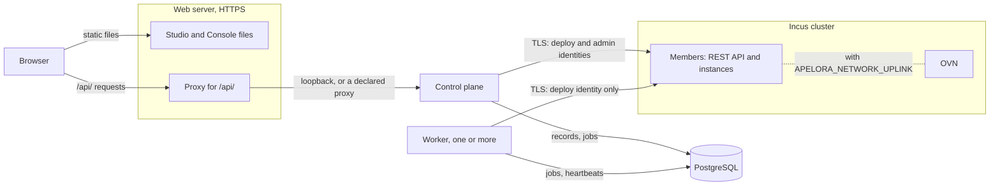

This page installs the control plane, the worker, PostgreSQL and the two web screens (Studio and Fabric Console) on top of an Incus cluster. Before you start, finish [servers and network](servers-and-network.md) and [install Incus](install-incus.md). You need what they produce: the cluster's address, its certificate, the two client certificates and the project name.

Values you choose are written as variables, for example `$DB_HOST`. Nothing here needs a fixed address, name or path.

## What runs where

| Part | What it is | Where it runs |
|---|---|---|
| **Control plane** (`apelora-control-plane`) | The API: plans, roles, audit | One process, near the database |
| **Worker** (`apelora-deployment-worker`) | Carries out jobs, enforces the network, replaces lost replicas | One or more processes |
| **PostgreSQL** | Apelora's own records, not your applications' data | Anywhere both can reach |
| **Studio and Console** | Two sets of static files | Any web server, over HTTPS |

Apelora is not in the data path: running instances keep running if the control plane, the worker or the database is down ([the control plane or the worker is down](../runbooks/api-outage.md)).

How the parts connect once this page is done:



## 1. PostgreSQL

Create a role and a database for Apelora on any PostgreSQL server that the control plane and the worker can reach. Development uses the version in `infra/dev/compose.yaml`. Both services create and upgrade the schema whenever they connect, so the role needs the right to create tables in its own database.

```sh
DB_USER=...  DB_NAME=...  DB_HOST=...
sudo -u postgres createuser --pwprompt "$DB_USER"
sudo -u postgres createdb --owner "$DB_USER" "$DB_NAME"
# DATABASE_URL=postgres://$DB_USER:<password>@$DB_HOST:5432/$DB_NAME   (use TLS between hosts)
```

Plan backups now: [back up and restore Apelora's own database](../runbooks/apelora-database-backup.md).

## 2. Get the programs

### From a release

Each release has both services for x86-64 and ARM64, each screen as its own archive, and SHA-256 (Secure Hash Algorithm) checksums. Releases are at <https://github.com/Apelora/apelora-fabric/releases>. Download the files and check them:

```sh
TAG=...          # the release's tag
ARCH=...         # x86_64 or aarch64
BASE=https://github.com/Apelora/apelora-fabric/releases/download/$TAG

for part in apelora-control-plane apelora-deployment-worker; do
  curl -fLO "$BASE/$part-$TAG-linux-$ARCH.tar.gz"
done
curl -fLO "$BASE/SHA256SUMS-services-$ARCH"
curl -fLO "$BASE/apelora-studio-$TAG.tar.gz"
curl -fLO "$BASE/apelora-fabric-console-$TAG.tar.gz"
curl -fLO "$BASE/SHA256SUMS-apps"
sha256sum --check --ignore-missing SHA256SUMS-services-$ARCH SHA256SUMS-apps
```

The last command prints `OK` after each file name. Do not continue if any file fails.

Each service archive holds the program, the `LICENSE` and the `README.md`. Each screen archive holds the files to serve.

### From source

You need the Rust toolchain the repository pins (`rust-toolchain.toml`; `rustup` installs it) and the Node.js version that `engines` in `package.json` names:

```sh
git clone https://github.com/Apelora/apelora-fabric && cd apelora-fabric
git checkout "$TAG"                      # a release tag, or main for the newest
cargo build --release -p apelora-control-plane -p apelora-deployment-worker   # target/release/
npm ci && npm run build                  # apps/studio/dist and apps/fabric-console/dist
```

## 3. Configure

Both services read environment variables. Put them in a file that only root can read, and give that file to your service manager. Secrets come from that file or from your secret store, never from the repository. The [settings reference](../architecture/SETTINGS.md) lists every setting with its default. These are the settings you need to start:

```sh
# /etc/apelora/apelora.env   (root:root, mode 0600)   -- both services
DATABASE_URL=postgres://...                       # without it the control plane runs without sign-in, on loopback only
APELORA_INCUS_URL=https://$SERVER_IP:8443         # any cluster member
APELORA_INCUS_CLIENT_CERT=$DIR/deploy.crt         # the restricted deploy identity
APELORA_INCUS_CLIENT_KEY=$DIR/deploy.key
APELORA_INCUS_SERVER_CERT=$DIR/cluster.crt        # the cluster's certificate: Apelora pins it
APELORA_INCUS_TLS_SERVER_NAME=$CERT_NAME          # the name inside that certificate, if not the URL's host
APELORA_DEPLOY_PROJECTS=$PROJECT                  # the Incus projects Apelora may change

# the control plane only
APELORA_INCUS_ADMIN_CLIENT_CERT=$DIR/admin.crt    # the unrestricted identity: never give it to the worker
APELORA_INCUS_ADMIN_CLIENT_KEY=$DIR/admin.key
APELORA_API_ADDR=...                              # where the API listens; loopback by default
APELORA_TLS_CERT=... APELORA_TLS_KEY=...          # TLS of its own, or APELORA_BEHIND_PROXY=1 behind a proxy that terminates it

# with OVN (see install Incus, step 4)
APELORA_NETWORK_UPLINK=$UPLINK
APELORA_SERVICE_ADDRESSES=$SERVICE_RANGE
```

To listen on any address other than loopback, the control plane needs a database and either TLS (Transport Layer Security) of its own or a declared proxy. Otherwise it refuses to start.

Without `APELORA_NETWORK_UPLINK`, Apelora deploys but does not enforce the connections you draw.

Optional features have their own settings, each described on its own page: volumes and backups (`APELORA_VOLUME_POOL`, `APELORA_BACKUP_POOL`), alerts, fencing and sign-in.

## 4. Run the services

Run both services under a service manager, so they restart after a failure. The repository has example systemd units in [`infra/systemd/`](../../infra/systemd/): `apelora-control-plane.service` and `apelora-deployment-worker.service`. Both use the same environment file and run as a dedicated `apelora` account.

1. Create the account, and install the two programs where the units expect them (from source, they are in `target/release/`):

   ```sh
   useradd --system --no-create-home --shell /usr/sbin/nologin apelora
   tar -xzf apelora-control-plane-$TAG-linux-$ARCH.tar.gz
   tar -xzf apelora-deployment-worker-$TAG-linux-$ARCH.tar.gz
   install -m 0755 apelora-control-plane-$TAG-linux-$ARCH/apelora-control-plane /usr/local/bin/
   install -m 0755 apelora-deployment-worker-$TAG-linux-$ARCH/apelora-deployment-worker /usr/local/bin/
   ```

2. Put the Incus certificates and keys under `/etc/apelora`, not in a home directory: the units set `ProtectHome=true`. `$DIR` in step 3 is then `/etc/apelora`. The `apelora` account must be able to read them. It does not need to read `/etc/apelora/apelora.env`: systemd reads that file as root before it starts the service, so keep it `root:root`, mode `0600`.

3. Copy the two units to `/etc/systemd/system/`, then start them:

   ```sh
   systemctl daemon-reload
   systemctl enable --now apelora-control-plane apelora-deployment-worker
   systemctl is-active apelora-control-plane apelora-deployment-worker
   ```

   The last command prints `active` twice.

Both services write one line per event to standard output. Set `APELORA_LOG_FORMAT=json` for structured logs. For metrics, logs, traces and an example collector (Prometheus, Loki, Tempo, Pyroscope, Grafana), see [monitoring](../architecture/MONITORING.md).

You can run several workers at once: they share the job queue safely. Never give a worker the administrator Incus identity.

## 5. Serve Studio and Console

Serve the two screens as static files over HTTPS, each on its own host name. Each host passes `/api/` to the control plane, so each browser talks to one origin only.

The repository's example, [`infra/serve/apelora.conf`](../../infra/serve/apelora.conf), is written for NGINX. It also sets the security headers and the content security policy. Adapt its host names and certificate paths, and keep the headers.

```sh
install -d -m 0755 /srv/apelora/studio /srv/apelora/console /etc/apelora/serve
tar -xzf apelora-studio-$TAG.tar.gz -C /srv/apelora/studio
tar -xzf apelora-fabric-console-$TAG.tar.gz -C /srv/apelora/console
install -m 0644 infra/serve/apelora.conf infra/serve/api-proxy.conf infra/serve/web-security-headers.conf /etc/apelora/serve/
# include /etc/apelora/serve/apelora.conf from NGINX's configuration, then:
nginx -t && systemctl reload nginx
```

Check that the API answers through the proxy, where `$CONSOLE_HOST` is the Console's host name:

```sh
curl -fsS "https://$CONSOLE_HOST/api/v1/health"
```

The answer contains `"status":"ok"` and, once the control plane reaches Incus, `"incus":{"connected":true}`.

## 6. Create the first administrator

```sh
DATABASE_URL=... apelora-control-plane token create --name "$ADMIN_NAME" --role fabric-admin
```

The command prints `Created token …`, then the token on the next line. The token is shown only once.

1. Sign in to the Console with the token. [Signing in](signing-in.md) shows how to add your identity provider afterwards.
2. Open **Servers → Preflight** and **Health**. They list anything not yet right, such as a project the deploy identity cannot see, or a member that is unreachable.

## 7. Add servers later

1. In the Console, open **Servers → Machines and join tokens**. Register the machine and approve it. The Console shows a single-use join token.
2. On the new server, run `scripts/enrol/enrol-member.sh` with that token. It joins the cluster and stays out of placement.
3. Admit the server in the Console after its checks pass.

The full procedure: [add a server to the cluster](../runbooks/member-join.md).

## Keep it healthy

- [Rotate Apelora's Incus certificates](../runbooks/certificates.md) before they expire. They last as long as you made them.
- Upgrade Incus one server at a time: [rolling upgrade](../runbooks/incus-rolling-upgrade.md).
- Keep the [runbooks](../runbooks/README.md) at hand.
- Without internet access: [running without internet access](../architecture/DISCONNECTED.md).

## Before you rely on it

- Apelora has run against a lab of virtual machines, and these units and the NGINX example have run on one lab server. It has not yet run on a production host. Treat your first installation as an evaluation, plan a trial before production, and report what you find.
- Releases so far are early previews (alpha versions).

What has been tested: [what works today](../architecture/current-state.md).
